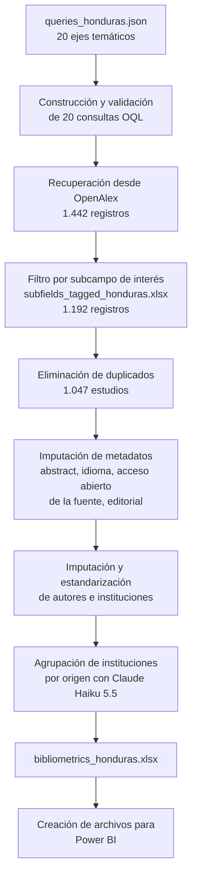
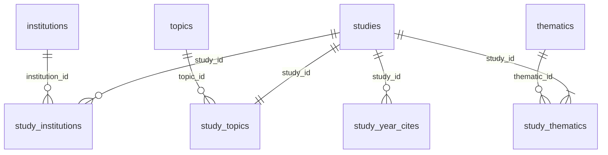

# Metodología del análisis bibliométrico

**Fecha del documento**: 2026-11-23

Este documento describe la metodología implementada en el flujo de procesamiento de datos para la automatización del reporte bibliométrico. A manera explicativa la metodología se desarrollará en torno al caso del Reporte bibliométrico de Honduras (2019-2026), pero los diferentes pasos metodológicos se extienden para la replicación de cualquier país.

A continuación se muestra cómo se construyen `bibliometrics_honduras.xlsx` y `bibliometrics_honduras_db.xlsx` en el desarrollo del procesamiento de datos bibliométricos, la base de estudios académicos sobre Honduras que alimenta el reporte bibliométrico, en versión plana y en versión relacional. Aquí se explican los insumos, cada etapa y las decisiones que se tomaron.

## Contenido

1. [Objetivo y alcance](#1-objetivo-y-alcance)
2. [Insumos](#2-insumos)
3. [Flujo general](#3-flujo-general)
4. [Etapas del proceso](#4-etapas-del-proceso)
5. [Archivos de salida y diccionario de variables](#5-archivos-de-salida-y-diccionario-de-variables)
6. [Limitaciones](#6-limitaciones)
7. [Comparación con reportes manuales](#7-comparación-con-los-reportes-manuales)

[Anexo A. Comparación por eje temático y objetivo estratégico](#anexo-a-comparación-por-eje-temático-y-objetivo-estratégico)

---

## 1. Objetivo y alcance

- **Objetivo:** Identificar la producción académica y la literatura gris sobre un país de interés relacionada con su estrategia país del Banco Interamericano de Desarrollo (BID), y caracterizarla por diferentes características. Para mejor entendimiento se sigue el caso de Honduras.
- **Fuente principal:** [OpenAlex](https://openalex.org), un catálogo abierto de trabajos académicos (artículos, libros, informes, tesis…) con sus autores, instituciones, fuentes y temas.
- **Periodo Honduras:** publicaciones de 2019 a 2026.
- **Unidad de análisis:** el estudio. El archivo final tiene una fila por estudio.

Los conteos presentados están sujetos a la fecha de ejecución del desarrollo, tomelos como referencia.

## 2. Insumos

| Insumo | Descripción | Uso en el proceso |
|---|---|---|
| `queries_<país>.json` | Definición del país, el periodo y los ejes temáticos con sus palabras clave | Construcción de las consultas a OpenAlex y asignación del eje temático |
| `subfields_tagged_<país>.xlsx` | Los 252 subcampos de la taxonomía de OpenAlex, marcados como de interés (1) o no (0) | Filtro temático de los estudios |
| API de OpenAlex | Búsqueda de trabajos, consulta de autores e instituciones, y catálogos vigentes de tópicos y subcampos | Recuperación de estudios, imputación, tabla `topics` y control del archivo de subcampos |
| Semantic Scholar | Base de datos bibliográfica con resúmenes (abstracts) | Imputación de abstracts |
| doi.org (Crossref / DataCite) | Registros oficiales de los DOI | Imputación de la editorial |
| API de ROR | *Research Organization Registry*, registro internacional de organizaciones de investigación con identificador, país y tipo | Completar el país, el nombre o el tipo de instituciones |
| API de Anthropic (Claude Haiku 5.5) | Modelo de lenguaje grande | Agrupación de las instituciones por origen |

### 2.1 `queries_<país>.json`

Archivo con dos bloques:

- **`meta`**: parámetros generales de la búsqueda.
  - `country`: país del análisis ("Honduras"). También se usa como nombre de uno de los grupos de instituciones.
  - `start_year` / `end_year`: periodo (2019–2026).
  - `country_terms`: términos que identifican al país en inglés y español. Por ejemplo, Honduras, Honduran, Hondurans, hondureño/a/os/as y afrohondureño/a/os/as.
- **`thematics`**: los ejes temáticos definidos por expertos para el país de análisis. Cada eje trae:
  - `thematic_id`: código único de n dígitos. Cada dígito representa la jerarquía de la estrategia.
  - `pillar`, `strategic_objective` y `expected_result`: la jerarquía de la estrategia (pilar → objetivo estratégico → resultado esperado → eje temático);
  - `thematic_axis`: nombre corto del eje temático;
  - `keywords`: palabras clave bilingües (inglés y español) para cada eje temático.


Ejemplo para Honduras

| Pilar | Objetivo estratégico | `thematic_id` | Eje temático | N.º keywords |
|---|---|---|---|---|
| 1. Mejorar la prestación de servicios públicos | 1.1 Calidad y acceso de los servicios públicos | 110 | Acceso y calidad de servicios | 10 |
| | | 111 | Agua y saneamiento | 12 |
| | | 112 | Acceso a electricidad | 11 |
| | | 113 | Movilidad urbana | 8 |
| | | 114 | Seguridad ciudadana | 11 |
| | 1.2 Capital humano y protección social, con enfoque en población vulnerable | 120 | Población vulnerable | 6 |
| | | 121 | Salud | 10 |
| | | 122 | Educación | 10 |
| | | 123 | Protección social | 6 |
| 2. Fortalecer la efectividad del gobierno | 2.1 Sostenibilidad fiscal | 210 | Sostenibilidad fiscal | 10 |
| | | 211 | Administración tributaria | 8 |
| | | 212 | Gasto público | 11 |
| | 2.2 Capacidad institucional y marcos regulatorios | 222 | Capacidad institucional | 18 |
| | | 223 | Gestión del riesgo y resiliencia | 7 |
| 3. Integración económica y productividad del sector privado | 3.1 Infraestructuras productivas y corredores económicos | 311 | Sistema eléctrico | 13 |
| | | 312 | Infraestructura logística | 8 |
| | | 313 | Facilitación del comercio | 6 |
| | 3.2 Rendimiento de la empresa y acceso a financiación | 321 | Productividad empresarial y financiamiento | 21 |
| | | 322 | Adopción tecnológica | 10 |
| | 3.3 Vías hacia el empleo formal | 331 | Mercado laboral | 16 |

### 2.2 `subfields_tagged_<país>.xlsx`

OpenAlex clasifica cada trabajo en una jerarquía de cuatro niveles: **tópico → subcampo (*subfield*) → campo (*field*) → dominio**. El tópico principal de un trabajo lo asigna un modelo de OpenAlex a partir del título, el abstract y la fuente.

La tabla de subcampos se origina en `oa_subfields.xlsx`, con los 252 subcampos agrupados en 26 campos. Sus columnas son:
- `id`, `name` y `name_alternative`: código, nombre y nombres alternativos;
- `description`: descripción, tomada de Wikidata (actualizada con la de la API de OpenAlex el 2026-11-19);
- `field`: campo al que pertenece;
- `url`: página del subcampo en OpenAlex.

Sobre esa tabla se agregaron dos columnas:
- `interest_subfield`: 1 si el subcampo es de interés para el análisis, 0 si no;
- `justificacion`: el eje o los ejes temáticos que justifican cada 1, para que la decisión se pueda auditar.

**Versión usada para Honduras** Se hizo con asistencia de Claude Opus 5.5, en estos pasos:

1. **Matriz de relevancia por eje.** Para cada uno de los 20 ejes se identificaron las disciplinas de OpenAlex en las que se publicaría esa literatura. Por ejemplo, el eje de agua y saneamiento se publica en ciencias del agua, ingeniería ambiental y salud pública.
2. **Criterio de inclusión.** Un subcampo es de interés si es razonable que una parte relevante de los artículos sobre algún eje quede clasificada ahí. El foco está en **política pública y prestación de servicios**, no en ciencia básica. Por ejemplo, *Water Science and Technology* y *Public Health* entran; *Organic Chemistry* o *Astrophysics* no.
3. **Casos frontera.** Ante la duda se optó por incluir, para no perder estudios pertinentes. Por ejemplo, las especialidades médicas ligadas a la capacidad hospitalaria, la agronomía por la adopción tecnológica agrícola y la ingeniería civil por la infraestructura.
4. **Verificación con la página de OpenAlex.** Cuando el nombre o la descripción no bastaban, se revisaron los tópicos que agrupa el subcampo en su página de OpenAlex.
5. **Justificación.** A cada subcampo marcado se le registró el eje o los ejes que lo justifican.
6. **Control final.** Se revisó el conteo por campo y se verificó que los 20 ejes quedaran cubiertos por al menos un subcampo. Además, se revisó manualmente cada uno de los subcampos marcados como de interés.

**Resultado:** 86 subcampos de interés y 166 excluidos, con los 20 ejes cubiertos. Los ejes que más subcampos justifican son Salud (121), Capacidad institucional (222) y Agua y saneamiento (111).

Quedaron excluidas la ciencia básica y las especialidades clínicas sin relación con los ejes: química, física, matemáticas, ciencia de materiales, bioquímica, neurociencia, artes y humanidades, odontología, veterinaria y especialidades por órgano como cardiología u oncología.

---

## 3. Flujo general

El siguiente diagrama muestra el flujo de las diferentes etapas del proceso con datos de Honduras para mayor entendimiento.


---

## 4. Etapas del proceso

### 4.1 Construcción de las consultas (OQL)

Las consultas usan **OQL** (*OpenAlex Query Language*), el lenguaje de consulta de OpenAlex. Se construye **una consulta por eje temático** con la siguiente estructura:

```
get works where year >= <año de inicio> and year <= <año de fin>
  and type is (article or report or dissertation or book or book-chapter or conference-paper or dataset or data-paper)
  and title-abstract has ((<términos de país>) AND (<palabras clave del eje>))
```

Decisiones clave:
- **Una consulta por eje.** Así el eje de cada estudio sale de la propia búsqueda, sin un paso posterior de clasificación, y las búsquedas son más específicas.
- **Campo de búsqueda `title-abstract`.** Los términos deben aparecer en el título o el resumen del trabajo, no en sus palabras clave ni en el texto completo.
- **Términos de país AND palabras clave.** El estudio debe referirse al país y a algún tema del eje.
- **Stemming.** Por defecto, las palabras clave se buscan con `stemmed`, que también encuentra las variantes morfológicas (singular y plural, conjugaciones). Por ejemplo, "public service" encuentra "public services". Con el parámetro `--no-stemming` de `run_pipeline.py` (archivo principal del flujo) las palabras clave se buscan como frase exacta. Los términos de país no cambian con este parámetro: los de una sola palabra se buscan sin stemming, porque el archivo ya lista sus variantes ( por ejemplo hondureño, hondureña, hondureños, etc), y los de varias palabras con stemming.
- **Tipos de documento.** Se admiten 8 tipos de producción académica, literatura gris y datos: artículos (`article`), informes (`report`), tesis (`dissertation`), libros (`book`), capítulos (`book-chapter`), ponencias (`conference-paper`), conjuntos de datos (`dataset`) y artículos de datos (`data-paper`). Se excluyen tipos como resúmenes de congreso, erratas o editoriales.

### 4.2 Validación de las consultas

Antes de ejecutarlas cada consulta, estas se valida de forma automática con el endpoint gratuito de OpenAlex. Este endpoint traduce y valida la OQL sin ejecutarla. Se exige que todas las consultas sean válidas para continuar.

El aviso `url_not_representable` es esperado y se ignora. Significa que la consulta no tiene equivalente en la sintaxis clásica de URL de OpenAlex, porque mezcla búsquedas con y sin stemming en el mismo OR. No afecta la ejecución.

### 4.3 Recuperación de estudios

Cada consulta por eje temático se envía con una petición `POST` a la API de OpenAlex. La paginación es por el campo `cursor` (un marcador que indica a la API dónde continuar), con 100 resultados por página y un máximo de 10.000 por consulta, lo que invita a definir objetivos específicos granulares y palabras clave puntuales.
Los resultados de la búsqueda se ordenan por `relevance_score`, el puntaje con que OpenAlex mide qué tan bien coincide el trabajo con la búsqueda. Este orden puede repetir algunos trabajos entre páginas, así que se eliminan las repeticiones por identificador dentro de cada consulta. Si falla una página intermedia, se conservan las páginas ya obtenidas y se registra que la consulta quedó incompleta.

La respuesta completa de cada eje se guarda como `thematic_{thematic_id}.json` como respaldo, junto con la OQL que la generó (`meta.pipeline_oql`).


Por defecto, cada ejecución borra los respaldos y vuelve a consultar todos los ejes, a manera de actualización para trabajar con los datos vigentes de OpenAlex. 

Existe en flujo también el parámetro `--no-update` de `run_pipeline.py` que permite reutilizar los respaldos. Este modo sirve para retomar una ejecución que falló, actualizar solo algunos ejes temáticos o reproducir una ejecución anterior. En ese modo, si la OQL de un eje cambió (tipos, campo de búsqueda, palabras clave o stemming), el proceso se detiene antes de consultar e indica qué respaldos borrar, para no mezclar resultados de búsquedas distintas.

### 4.4 Construcción de variables

De cada trabajo se conservan las variables de interés como por ejemplo:
- identificación y fechas
- idioma y tipo
- ubicación principal
- acceso abierto
- citas e impacto
- tópico principal y su jerarquía
- Objetivo de Desarrollo Sostenible (ODS) principal.

Además, se trabaja con objetos anidados que se transforman así:
- **Autores** (`authorships`, la lista de autorías del trabajo): el identificador y el nombre de cada autor se unen con ";", en el orden de autoría.
- **Instituciones:** las instituciones únicas del estudio (por identificador, en orden de aparición). Su identificador, nombre, país (`country_code`, código ISO de dos letras) y tipo se unen con ";", alineados entre sí. Las columnas de instituciones no están alineadas con las de autores: tienen una posición por institución, no por autor.
- **Abstract:** OpenAlex no entrega el resumen como texto, sino como un índice invertido (cada palabra con las posiciones en que aparece). Se reconstruye ordenando las palabras por posición y eliminando los caracteres no imprimibles.
- **Keywords:** las palabras clave que OpenAlex asigna al trabajo, unidas con ";".

El listado completo de variables de OpenAlex y la indicación de sis son usadas o no se encuentra en [docs\diccionario_works_openalex.xlsx](https://github.com/ansesame/Reporte_bibliometrico/blob/main/docs/diccionario_works_openalex.xlsx).

### 4.5 Filtro por subcampo de interés

Cada estudio se cruza con `subfields_tagged_<país>.xlsx` por el subcampo de su tópico principal (`primary_topic.subfield`), y se conservan solo los estudios de subcampos de interés. Aquellos estudios sin subcampo son descartados debido a que son registros de spam, anuncias o números que OpenAlex mismo no pudo clasificar.

A pesar de los documentos de referencia donde se realizaba el filtro temático por medio de tópico principal, aquí se realiza por medio del subcampo por su mayor facilidad de estandizar y reetiquetar para cada país. OpenAlex define 4.516 tópicos, frente a solo 252 subcampos.

### 4.6 Eliminación de duplicados

Un mismo estudio puede aparecer en varias consultas (si coincide con varios ejes) o con registros distintos (por ejemplo, la versión de la revista y la del repositorio). Los duplicados se identifican **en cascada**:

1. **Identificador de OpenAlex** (`id`).
2. **DOI** (*Digital Object Identifier*, identificador permanente de una publicación).
3. **Título normalizado** (minúsculas, sin tildes ni signos de puntuación, espacios simplificados), solo si el título original tiene **4 palabras o más**. Así no se fusionan títulos genéricos como "Honduras" o "Introduction".

En cada paso se ignoran los valores vacíos.

Reglas para fusionar o descartar estudios:
- Se conserva la fila con mayor `relevance_score`.
- **Eje temático:** se identifica el objetivo estratégico del eje con mayor puntaje de relevancia entre las filas duplicadas. Así, se conservan todos los ejes temáticos de ese objetivo en los que apareció el estudio. Los ejes de otros objetivos se descartan, de modo que cada estudio queda asociado a un solo objetivo estratégico.

Por ejemplo, un estudio aparece en 3 ejes temáticos diferentes, 211, 212 y 311; y el estudio con mayor puntaje de relevancia es el del eje 212. Así, se conserva la observación de la fila respectiva y se le asignan los ejes 211 y 212 dado que pertenecen al mismo objetivo estratégico.

### 4.7 Imputación de metadatos

Primero, los textos vacíos se convierten en valores nulos para tratarlos de forma uniforme.

**DOI.** No se imputa. 
En el ejemplo de Honduras, faltan 144 (13,8 %), concentrados en tesis (90 % sin DOI) e informes (27 % sin DOI). Prevalece la literatura gris alojada en repositorios, que normalmente no registra DOI. Ninguna URL de esos estudios contiene un patrón de DOI, y las demás ubicaciones del trabajo en los respaldos tampoco lo traen.

**Abstract.** Si OpenAlex no lo trae, se busca por DOI en *Semantic Scholar*, con consultas por lotes de 100 estudios.
En Honduras se pudieron imputar 21 de Semantic Scholar y quedaron 45 sin abstract.
- `abstract_source` indica la fuente.

Los DOIs que siguen sin abstract son en su mayoría de Springer y Elsevier, sobre todo ponencias y capítulos de libro. Estas editoriales no publican sus abstracts en fuentes abiertas. También se probaron Crossref, DataCite y OpenAIRE con los DOIs sin abstract, pero no hubo existo en Honduras ni en pruebas con Ecuador.

**Idioma.** Cuando OpenAlex no informa el idioma, se detecta con la librería `lingua`, restringida a 6 idiomas (inglés, español, portugués, francés, italiano y alemán).
Se usa primero el título y si no es exisoto, el abstract. En los estudios con idioma conocido, la detección sobre el título coincide con OpenAlex en 93 % y sobre el abstract en 84 %, teniendo en cuenta que estudios en español pueden traer el abstract traducido al inglés.

Se agrega la variable `language_imputed` (Verdadero/Falso) que marca los estudios donde se imputa.


**Editorial (`publisher`).** Se construye una sola variable de editorial u organización que publica el estudio para unificar diferentes niveles de descripción del origen y valores faltantes. Se toma el primer valor disponible de esta cascada:

| Orden | Fuente | Descripción | Estudios en Honduras|
|---|---|---|---|
| 1 | `host_organization_name` | Organización que publica o aloja la fuente en OpenAlex (editorial, universidad, organismo) | 785 |
| 2 | `primary_location.source.display_name` | Nombre de la fuente (revista, repositorio, plataforma de libros) | 191 |
| 3 | `primary_location.raw_source_name` | Nombre de la fuente tal como aparece en el registro original, sin normalizar | 17 |
| 4 | Registro del DOI | Editorial registrada para el DOI en Crossref o DataCite, consultada por doi.org | 32 |
| 5 | Dominio de `landing_page_url` | Dominio de la página web donde se aloja el estudio. Los enlaces doi.org se resuelven a su destino final; algunos dominios conocidos se traducen a nombre, p. ej. documents.worldbank.org → World Bank | 22 |

Se crea la variable `publisher_source` que indica que indica la fuente aportó el valor.

**Acceso abierto.** Se conserva `open_access.oa_status`, como referencia principal. La clasificación de OpenAlex es:
- gold: revista de acceso abierto con cargo al autor
- diamond: acceso abierto sin cargos
- hybrid: artículo abierto en una revista de suscripción
- green: existe una copia en un repositorio
- bronze: libre en el sitio de la editorial, pero sin licencia abierta
- closed: cerrado

**Acceso abierto de la fuente (`primary_location.source.is_oa`).** Indica si la fuente de la versión principal (revista, repositorio o plataforma) es completamente de acceso abierto. Es una propiedad de la fuente, no del estudio, por eso difiere de `open_access.is_oa`. 

En Honduras, 350 estudios definen el estudio como de acceso abierto mientras su fuente no es de acceso abierto. El caso contrario no ocurre, aún en pruebas con Ecuador con 10 vecez más artículos. Además, este campo no es ajeno a los nulos en OpenAlex. En Honduras 71 estudios(6,8 %), en su mayoría informes y otra literatura gris, no tienen el indicativo del acceso abierto a la fuente.

Este campo se imputa desde el estado del acceso abierto del estudio (`open_access.oa_status`) de tal manera que:
  - gold y diamond → `True`: Por definición, ambos estados implican una revista de acceso abierto.
  - hybrid, bronze y closed → `False`: Implican que la revista es de suscripción aún si el estudio es abierto.
  - green → `NA`: No se imputa, porque es ambiguo y no da certeza sobre la fuente.

En este caso también se agregó una variable que permite identificar si la variable fue imputada, `source_is_oa_imputed`. 


**FWCI y percentil de citas**

El **FWCI** (*Field-Weighted Citation Impact*) divide las citas recibidas en el año de publicación y los tres siguientes por las citas esperadas para trabajos del mismo año, tipo y subcampo, donde 1,0 es el promedio mundial. Por su parte, el **percentil normalizado de citas** expresa lo mismo en escala percentil, donde un estudio con un valor mayor a 90 indica que está en 10% más citado.
OpenAlex no calcula estos indicadores para los tipos que no se espera que acumulen citas, como lo son los informes, tesis y conjuntos de datos. De tal manera que los nulos significan que no aplican, no un impacto cero. Esto implica que no deben imputarse los valores con 0 dado que se mezclarían con estudios elegibles sin impacto.

En el ejemplo de Honduras, los 149 nulos son exactamente informes, tesis y conjuntos de datos, igual que en pruebas de Ecuador.

### 4.8 Autores e instituciones

Autores e instituciones se tratan como entidades independientes. Las columnas unidas con ";" se separan en listas, se completan y se vuelven a unir.

**Criterio de alineación.** En cada estudio, todas las columnas de un mismo grupo tienen el mismo número de elementos, en el mismo orden:
- **Autores:** identificador (`authorships.author.id`), nombre (`.display_name`) y marca de imputación (`.id_imputed`).
- **Instituciones:** identificador, nombre, país, tipo, organización raíz (`.root_display_name`) y agrupación (`.inst_group`).

**Valores faltantes.** Hay dos casos distintos:
- Falta un elemento dentro de un campo con varios valores: Por ejemplo un autor sin identificador entre autores que sí lo tienen, o una institución sin país, en estos casos se reemplaza por "Not indicated" para conservar la posición y la alineación.
- Falta el campo completo: Por ejemplo un estudio sin ningún autor o sin ninguna institución, aquí todo el grupo queda vacío (nulo).

Las fases siguientes (a-e) se aplican en orden y se usan para imputar estudios sin instituciones. Para estudios sin ningún autor se probaron como fuentes de imputación el registro del DOI y la página web del estudio, pero ninguna los recupera de forma útil. Muchos son documentos de autoría institucional, que se tratan como se presenta después.

#### a) Autores que son instituciones

En OpenAlex, algunos "autores" son organizaciones (World Bank, OECD, BID…), pero no son identificadas como tal. Para identificar de forma general estos casos casos se usa en primer paso dos condiciones para filtrar candidatos:

  1. No tienen id de autor, o tienen un perfil sin afiliaciones y sin ORCID en un estudio de hasta 3 autores. Los estudios con más autores se asumen escritos por personas, para evitar consultas con poca relevancia. El ORCID es un identificador personal de investigadores que una organización no puede tener, así que un perfil con ORCID es una persona.

  2. Su nombre tiene forma de organización. Es decir, contiene alguna de estas señales:
     - Una palabra o prefijo de organización, como universidad, instituto, ministerio, banco, etc.
     - La sigla de un organismo, como CEPAL, OECD, FMI, BID, etc.
     - Una forma jurídica, como S.A., Ltda. o Inc..
     - Un "&";
     - Un término de país del archivo de queries.
     - Solo una palabra en mayúscula
     
     Las listas están en español, inglés, portugués y francés.

El segundo paso es la búsqueda de cada nombre en el catálogo de instituciones de OpenAlex para confirmar que existe como institución. Se asigna como institución comparando el nombre normalizado con cada uno de los resultados de la búsqueda en OpenAlex teniendo en cuenta que:
  - La institución se asigna si la similitud entre textos es mayor o igual 0,85. La similitud se mide por el emparejamiento de patrones Gestalt de Ratcliff y Obershelp, en una escala de 0 a 1 donde 1 es idéntico.
  - Se elige la institución más similar de los primeros 10 resultados, porque la coincidencia exacta no siempre aparece primera.
  - Si el nombre completo no coincide, se prueba con su primer segmento antes de ".", "," o "(". Por ejemplo, "International Monetary Fund. Fiscal Affairs Dept." se reconoce como "International Monetary Fund".

De esta manera se asigna la institución a todos los estudios pertinentes y se marca con `author_as_institution` la variable `institutions_source` que permite identificar los valores imputados. 

Para el caso de Honduras, hubo 10 nombres reconocidos, que corresponden a 9 instituciones: BID, Banco Mundial, World Bank Group, FMI, OCDE, PNUD, CEPAL, IFC y la Universidad Nacional de Ciencias Forestales. Algunos nombres son variantes de la misma institución, que luego serpan estandarizados.

**Justificación del filtro de nombre con forma de organización.** Sin el filtro, en Ecuador se buscaron 6.668 nombres (USD ~7, casi todo el costo de la corrida) y solo 55 resultaron ser instituciones. Casi todas eran afiliaciones que OpenAlex registró como autor ("Universidad de Guayaquil. Ecuador") u organismos (World Bank, CEPAL, FMI). Ninguna tenía ORCID. Al volver a correr Ecuador con el filtro, se buscaron 105 nombres y se conservaron todas las coincidencias reales. El costo de la imputación bajó de USD 7,93 a USD 1,16. En Honduras se conservaron las mismas 10 coincidencias.


#### b) Publisher como autor institucional

Para los estudios sin ninguna autoría cuya fuente no es una revista, se busca la editorial como institución, con el mismo método y umbral de similitud del segundo paso en a). Se asigna como autor y como institución (`publisher_as_author` en `institutions_source`) solo si el tipo de la institución es gobierno, organización sin fines de lucro, salud, instalación, financiador u otro. Se excluyen las empresas y empresas, porque son editoriales comerciales que no son autoras del contenido, o alojan documentos sin firmarlos, por ejemplo Springer o un repositorio universitario.

En Honduras, de los 8 estudios sin autores, 7 son candidatos (el otro tiene una revista como fuente) y 5 se imputan, 4 de Naciones Unidas y 1 de la Organización Panamericana de la Salud (OPS), que OpenAlex registra como World Health Organization Regional Office for the Americas.

#### c) Identificador para autores sin identificador

En los estudios que siguen sin instituciones, se busca en el catálogo de autores de OpenAlex a las personas sin identificador, casos donde hay un texto del nombre pero no un identificador. El identificador permite recuperar después sus afiliaciones.

El identificador se asigna si se cumplen dos condiciones:
1. El candidato tiene el mismo nombre normalizado y una afiliación a ±1 año de la publicación, ya que un autor sin afiliaciones no sirve.
2. Es el único candidato que cumple 1, o todos los candidatos válidos comparten una institución, que se interpretan como perfiles duplicados de la misma persona en OpenAlex y se elige el de mayor relevancia.

La regla se eligió con una evaluación previa sobre los datos de Honduras, donde se midió la precisión ocultando el identificador de 55 autores conocidos y marcando cuantos fueron asignados correctamente. Además, la cobertura se midió sobre 100 autores sin identificador. A continuación los resultados de diferentes pruebas.

| Regla | Precisión (autores con id) | Cobertura (autores sin id) |
|---|---|---|
| R0. Primer resultado con afiliaciones | 83 % | 80 % |
| R1. Nombre exacto | 88 % | 65 % |
| R2. Nombre exacto y mismo campo temático | 91 % | 40 % |
| R3. Nombre exacto y afiliación ±1 año | 91 % | 50 % |
| **R4**. R3 con candidato único o candidatos que comparten institución | **95 %** | **30 %** |

La confiabilidad depende de que no haya homónimos de instituciones distintas, en esos casos la precisión cae. Por eso se elige una la regla que prima no asignar antes que arriesgarse a la presencia de un homónimo en búsquedas generales.

En Honduras, esta estrategia permitió imputar 20 identificadores de autores, que ocupan 24 estudios. Para el seguimiento, se crea `authorships.author.id_imputed` y se marca con `True` cada posición imputada.

#### d) Instituciones a partir de las afiliaciones de los autores

En los estudios que siguen sin instituciones se consulta el perfil en OpenAlex de cada autor con identificador (incluidos los imputados). Se toman las instituciones de sus afiliaciones registradas en el mismo año de publicación del estudio. Cada afiliación del perfil indica la institución y los años en que el autor estuvo vinculado a ella. Estas instituciones se marcan como `author_affiliation` en `institutions_source`.

#### e) Estandarización de instituciones

Una misma institución puede estar registrada de diferentes maneras a causa de estar escrita de diferentes maneras, errores de tipeo o diferentes ramas de una misma institución. Para corregir el problema y tener un seguimiento adecuado de las instituciones se realizan los siguientes pasos.

1. **Árbol institucional.** Se consulta en OpenAlex la ficha de cada institución y de todas sus organizaciones superiores (padre, abuelo, etc), recorriendo las relaciones institucionales que registra OpenAlex.

2. **Campos faltantes en instituciones.** El nombre, el país y el tipo de institución se completan en cascada en caso de nulos en cualquier campo: primero el valor obtenido desde el estudio, luego la ficha de la institución en OpenAlex (recurriendo a los padres si es necesario) y luego el Registro de Organizaciones de Investigación (ROR). Lo que siga faltando queda como "Not indicated".

3. **Identificador canónico.** Las instituciones con el mismo nombre normalizado y el mismo país, pero distinto identificador, se unifican en el identificador más frecuente en la base. Las instituciones con el mismo nombre en distintos países no se unifican, porque son entidades distintas, como entidades gubernamentales o universidades con nombres comunes.

4. **Organización raíz (`root_display_name`).** Se sube por las relaciones de tipo padre hasta llegar a una organización sin padre, de tal manra que permite tener un identificador central entre diferentes ramas de una misma institución. Si hay varios padres, se elige el del mismo tipo y, si empatan, el de más publicaciones. Así, un instituto o una facultad se asocia a su universidad o sistema; por ejemplo, The Queen's Medical Research Institute → University of Edinburgh y University of Florida → State University System of Florida.


**¿Por qué importa el orden?** 

Cada fase usa lo que dejan los anteriores y actúa solo sobre los estudios que siguen sin instituciones. Por eso, cambiar el orden cambia tanto el resultado como el costo:

1. **De la fuente más confiable a la menos confiable.** Las fuentes se usan en este orden:
   - las instituciones que trae el registro de OpenAlex;
   - las organizaciones que figuran como autoras
   - la editorial si se identifican como instituciones
   - las instituciones inferidas desde el perfil de los autores

2. **Cada paso reduce el trabajo, y el costo, del siguiente.** Una búsqueda por nombre cuesta unas 10 veces más que una consulta de una entidad (nombre o institución) específica ($0,001 frente a $0,0001).


3. **a) antes que c).** Los nombres reconocidos como instituciones (World Bank, OECD…) no se buscan después como personas. Así no se gastan búsquedas en nombres que no son de personas, ni se asigna por error el perfil de una persona a una organización.

4. **b) después de imputar el publisher (sección 4.7) y antes que c).** La editorial solo se puede buscar como institución cuando el publisher ya está completo. Los estudios que la reciben como autora institucional ya tienen institución, así que salen del grupo que se procesa en c).

5. **c) antes que d).** d) recupera instituciones a partir de las afiliaciones de los autores con identificador. Los identificadores imputados en c) son los que permiten recuperar instituciones en estudios donde ningún autor estaba identificado.

6. **e) al final.** La estandarización necesita todas las instituciones. Así se logra que el árbol institucional se consulte una sola vez, realice la unificación de identificadores y la organización raíz se aplique a todas por igual.

**Consultas en paralelo** 

Dentro de cada fase de la limpieza de instituciones, las consultas a OpenAlex se hacen en paralelo para reducir los tiempos de ejecución aprevechando que las consultas dentro de una misma fase no dependen entre si. A continuación la tabla muestra que fases se hicieorn por lotes.

| Fase | Consultas en paralelo |
|---|---|
| Preparación | Fichas de los autores con identificador, en lotes de 50 |
| a) Autores que son instituciones | Búsqueda de cada nombre candidato en el catálogo de instituciones |
| b) Publisher como autor | Búsqueda de cada editorial candidata en el catálogo de instituciones |
| c) Identificador para autores sin identificador | Búsqueda de cada par (nombre, año) en el catálogo de autores |
| d) Afiliaciones | Fichas de los autores que faltan, en lotes de 50 |
| e) Estandarización | Fichas del árbol institucional, en lotes de 50. Los niveles (padres, abuelos…) se recorren uno tras otro, porque cada nivel depende del anterior |

Usando como referencia las pruebas en Ecuador con más alrededor de , 16.000 estudio, la immputación tomaba ~2 horas con consultas secuenciales y sin el filtro de nombres en la fase a); con ambos cambios toma alrededor de 2 minutos.

Como anotación técnica, para no exceder el límite de OpenAlex, todas las consultas, de todos los hilos, pasan por un limitador común. El limitador separa el inicio de cada solicitud y usa 2/3 del límite por segundo de la clave, que lee del endpoint gratuito `/rate-limit` (20 solicitudes/s con el límite de 30/s de una clave gratuita o prepagada). Las consultas de ROR y a Claude siguen siendo secuenciales.

### 4.9 Agrupación de instituciones por origen

Cada institución se clasifica en uno de estos grupos:

| Grupo | Criterio |
|---|---|
| `<País>` | Instituciones del país del análisis (tomado de `meta.country`) |
| `LAC` | América Latina y el Caribe, excluyendo el país de análisis |
| `USA & Canada` | Estados Unidos y Canadá |
| `Europe` | Países europeos, incluido el Reino Unido |
| `Multilateral organizations` | BID, Banco Mundial, OCDE, FMI, Naciones Unidas y sus agencias (PNUD, UNICEF, FAO, OIT…), CEPAL, OPS/OMS, BCIE, SICA y similares, sin importar el país |
| `Other institutions` | Resto del mundo |
| `Not indicated` | No es posible determinar el origen con la información disponible |

Para esta clasificación no basta con usar el código del país debido a que hay instituciones que tienen alcance en diversos países y los organismos multilaterales tienen asignado el país de sus sede principal.

Por esta razón se optó por el uso de **Claude Haiku 5.5**, un modelo de lenguaje de Anthropic, por medio de su API. Para cada institución única se compartió con el modelo nombre, país, tipo y organización raíz y se le dió la instrucciones de:
  - Asignar exactamente una categoría a cada institución.
  - Dar prioridad a la categoría multilateral sobre el país, usando también la organización raíz para reconocer oficinas nacionales de organismos internacionales (p. ej. una oficina nacional cuyo raíz es UNICEF);
  - Inferir el país desde el nombre solo cuando sea una entidad reconocida y evidente.

Además, se definió una salida estructurada para que el modelo responda con un formato fijo (una lista de pares institución–grupo) cuyos valores posibles se construyen a partir de la lista de grupos previa. Así el modelo solo puede responder categorías válidas.


Para Honduras se clasificaron 812 instituciones únicas, presentes en 825 de los 1.047 estudios, distribuidas como se muestra en la tabla. Un estudio puede tener instituciones de varios grupos, por lo que la última columna no suma el total de estudios.

| Grupo | Instituciones únicas | Estudios con al menos una institución del grupo | % de los estudios |
|---|---|---|---|
| Honduras | 16 | 327 | 31,2 % |
| LAC | 262 | 244 | 23,3 % |
| USA & Canada | 213 | 200 | 19,1 % |
| Europe | 187 | 159 | 15,2 % |
| Multilateral organizations | 31 | 101 | 9,6 % |
| Other institutions | 103 | 51 | 4,9 % |
| Not indicated | 0 | 0 | 0,0 % |
| Sin instituciones | — | 222 | 21,2 % |

Ninguna institución quedó en `Not indicated`. Pocas instituciones hondureñas concentran muchos estudios con solo 16 instituciones. La Universidad Nacional Autónoma de Honduras (UNAH) participa en 188 estudios (18 %), seguida por la Universidad Tecnológica Centroamericana con 65 y la Universidad Pedagógica Nacional Francisco Morazán con 33. Entre los organismos multilaterales destacan el BID  con 20 estudios, el Banco Mundial con 18 y la OPS/OMS con 15.

---

## 5. Archivos de salida y diccionario de variables

El proceso entrega la misma información en dos formatos:

| Archivo | Estructura | Uso |
|---|---|---|
| `bibliometrics_honduras.xlsx` | Una sola hoja, con una fila por estudio y las entidades (autores, instituciones, ejes) como listas separadas por ";" | Revisión y auditoría: incluye las columnas que indican la fuente de cada imputación |
| `bibliometrics_honduras_db.xlsx` | Nueve hojas: una por entidad, una tabla puente por cada relación, las citas por año y los metadatos de la búsqueda | Análisis y tableros (Power BI): cada institución, tópico y eje aparece una sola vez y se relaciona con los estudios por llaves |

### 5.1 Base plana: `bibliometrics_honduras.xlsx`

Tiene una fila por estudio (1.047) y 48 columnas. En las columnas de lista, los valores se separan con ";". Las de autores están alineadas entre sí, y las de instituciones también.

| Variable | Descripción | Origen |
|---|---|---|
| `id` | Identificador del trabajo en OpenAlex | OpenAlex |
| `doi` | DOI (identificador permanente de la publicación) | OpenAlex |
| `display_name` | Título | OpenAlex |
| `relevance_score` | Puntaje de coincidencia con la búsqueda del eje (la fila conservada al deduplicar) | OpenAlex |
| `publication_year`, `publication_date` | Año y fecha de publicación | OpenAlex |
| `language` | Idioma (código ISO 639-1: en, es, pt…) | OpenAlex / imputado |
| `language_imputed` | `True` si el idioma se detectó con `lingua` | Construida |
| `primary_location.landing_page_url` | Página web donde se aloja la versión principal | OpenAlex |
| `primary_location.raw_source_name` | Nombre de la fuente tal como aparece en el registro original | OpenAlex |
| `primary_location.source.is_oa` | `True` si la fuente (revista, repositorio, plataforma) es completamente de acceso abierto. Es una propiedad de la fuente, no del estudio (ver sección 4.7) | OpenAlex / imputado |
| `source_is_oa_imputed` | `True` si `primary_location.source.is_oa` se imputó desde `open_access.oa_status` | Construida |
| `type` | Tipo de documento (article, book, report…) | OpenAlex |
| `open_access.is_oa` | Si el estudio tiene alguna versión de acceso abierto | OpenAlex |
| `open_access.oa_status` | Estado de acceso abierto (gold, diamond, hybrid, green, bronze, closed) | OpenAlex |
| `open_access.oa_url` | Enlace a la versión de acceso abierto | OpenAlex |
| `fwci` | *Field-Weighted Citation Impact*: citas relativas al promedio mundial de trabajos comparables (1 = promedio). Nulo cuando no aplica | OpenAlex |
| `cited_by_count` | Número de citas recibidas | OpenAlex |
| `citation_normalized_percentile.value` | Percentil de citas frente a trabajos comparables (0 a 1) | OpenAlex |
| `primary_topic.id`, `primary_topic.display_name` | Tópico principal del trabajo | OpenAlex |
| `primary_topic.subfield.*`, `.field.*`, `.domain.*` | Subcampo (código numérico), campo y dominio del tópico principal | OpenAlex |
| `openalex_updated_date` | Última actualización del registro en OpenAlex (no es la fecha de la extracción) | OpenAlex |
| `retrieved_date` | Fecha de la ejecución en que el estudio entró a la base. Cada ejecución es una actualización por defecto: los estudios que ya estaban en la base relacional anterior conservan su fecha y solo los nuevos reciben la fecha de la ejecución | Construida |
| `authorships.author.display_name` | Nombres de los autores, en orden de autoría | OpenAlex / imputado |
| `authorships.author.id_imputed` | Por autor, `True` si su identificador se imputó por búsqueda | Construida |
| `authorships.institutions.id` | Identificadores de OpenAlex de las instituciones únicas del estudio | OpenAlex / imputado |
| `authorships.institutions.display_name` | Nombres de las instituciones | OpenAlex / imputado |
| `authorships.institutions.country_code` | País de cada institución (ISO de dos letras) | OpenAlex / ROR |
| `authorships.institutions.type` | Tipo de institución (education, government, nonprofit, company, healthcare, facility, funder, other…) | OpenAlex / ROR |
| `authorships.institutions.root_display_name` | Organización raíz de cada institución | Construida |
| `authorships.institutions.inst_group` | Grupo de origen de cada institución | Construida (Claude Haiku 5.5) |
| `institutions_source` | Origen de las instituciones del estudio | Construida |
| `abstract` | Resumen | OpenAlex / Semantic Scholar |
| `abstract_source` | Fuente del resumen | Construida |
| `keywords` | Palabras clave asignadas por OpenAlex | OpenAlex |
| `sustainable_development_goals.display_name` | ODS con mayor puntaje asignado por OpenAlex. Vacío si no tiene ODS | OpenAlex |
| `thematic_id` | Eje o ejes temáticos del estudio (del mismo objetivo estratégico) | Construida |
| `thematic_axis` | Nombre de los ejes temáticos del estudio | `queries_honduras.json` |
| `pillar` | Pilar de la estrategia al que pertenecen los ejes | `queries_honduras.json` |
| `strategic_objective` | Objetivo estratégico de los ejes (uno por estudio, ver sección 4.6) | `queries_honduras.json` |
| `publisher` | Editorial u organización que publica | Construida (cascada) |
| `publisher_source` | Paso de la cascada que aportó la editorial | Construida |

`thematic_axis`, `pillar` y `strategic_objective` se toman de `queries_honduras.json` a partir de `thematic_id`. Si un estudio tiene varios ejes, se listan sin repetir los valores. El resultado esperado y las palabras clave de cada eje están en la hoja `thematics` de la base relacional.

### 5.2 Base relacional: `bibliometrics_honduras_db.xlsx`

La base plana se separa en tablas relacionadas por llaves. Las entidades (instituciones, tópicos y ejes temáticos) tienen su propia hoja, con una fila por entidad. Las tablas puente registran qué entidades corresponden a cada estudio. Así una institución tiene un solo nombre, país y grupo en toda la base, y los conteos por institución, tópico o eje no dependen de separar listas.

El diccionario completo de la base relacional está en [docs/diccionario_bibliometrics_bd.xlsx](https://github.com/ansesame/Reporte_bibliometrico/blob/main/docs/diccionario_bibliometrics_bd.xlsx). Para cada hoja y columna indica el tipo, la llave, el origen, el campo de OpenAlex del que proviene, los valores posibles y un ejemplo.



| Hoja | Llave | Filas | Contenido |
|---|---|---|---|
| `studies` | `study_id` | 1.044 | Una fila por estudio: metadatos, abstract, editorial, autores y citas |
| `institutions` | `institution_id` | 806 | Una fila por institución: nombre, país, tipo, organización raíz y grupo de origen |
| `study_institutions` | `study_id`, `institution_id` | 1.696 | Tabla puente estudio–institución |
| `topics` | `topic_id` | 4.516 | Catálogo completo de tópicos de OpenAlex con su subcampo, campo y dominio |
| `study_topics` | `study_id`, `topic_id` | 1.044 | Tabla puente estudio–tópico principal (`primary_topic`) |
| `thematics` | `thematic_id` | 20 | Ejes temáticos de `queries_honduras.json`, con sus palabras clave y su consulta OQL |
| `study_thematics` | `study_id`, `thematic_id` | 1.077 | Tabla puente estudio–eje temático |
| `study_year_cites` | `study_id`, `year` | 1.475 | Citas recibidas por cada estudio en cada año |
| `metadata` | — | 1 | Parámetros de la búsqueda y fecha de la última actualización |

**Reglas generales:**
- **Identificadores sin prefijo.** Los identificadores de OpenAlex se guardan sin `https://openalex.org/` (p. ej. `W3164576808`, `I169009895`). Los de tópicos, subcampos, campos y dominios se guardan como número (`T10795` → `10795`), igual que en `subfields_tagged_honduras.xlsx`.
- **Sin columnas de trazabilidad.** No se incluyen `institutions_source`, `publisher_source`, `language_imputed`, `source_is_oa_imputed`, `abstract_source` ni `authorships.author.id_imputed`. Para revisar el origen de una imputación se usa la base plana.
- **Controles.** Antes de exportar se verifica que las llaves sean únicas, que cada institución tenga un solo valor por atributo y que todos los identificadores de las tablas puente existan en su tabla de entidad.

## 6. Limitaciones

- **Cobertura institucional.** 222 estudios de Honduras (21,2 %) quedan sin instituciones, sobre todo documentos cuyos autores no tienen perfil o afiliaciones en OpenAlex. Los indicadores por origen institucional se calculan sobre los estudios con instituciones.
- **Imputación de autores.** La regla elegida tiene una precisión estimada del 95 %, pero solo recupera ~30 % de los autores sin identificador.
- **Clasificación de instituciones con un modelo de lenguaje.** No se validó manualmente de forma exhaustiva. Puede haber errores en instituciones con poca información (sin país o con nombres ambiguos). Además, el modelo no es determinista por lo que los conteos por grupo pueden variar ligeramente entre ejecuciones.

---

## 7. Comparación con reportes manuales

Antes del flujo automatizado descrito previamente, el procesamiento de los reportes bibliométricos se realizaba a mano. Esta sección compara las bases finales del flujo con las de los reportes manuales de Honduras y Ecuador. A continuación una tabla comparativa entre las estrategias utilizadas y los estudios recuperados.


| | Honduras manual | Honduras automatizado | Ecuador manual | Ecuador automatizado |
|---|---|---|---|---|
| Consultas | 8 (por objetivo estratégico) | 20 (una por eje) | 22 (una por eje) | 22 (una por eje) |
| Términos de país | "Honduras" | 11 términos incluyendo nombre y gentilicios en español e inglés | "Ecuador" | 11 términos incluyendo nombre y gentilicios en español e inglés |
| Palabras clave | Frases exactas | Se plica *stemming* (plurales, conjugaciones) | Frases exactas | Se aplica *stemming* (plurales, conjugaciones) |
| Resultados brutos | 1.521 | 1.442 | 13.802 | 22.288 |
| Obras únicas en los resultados brutos | No informado | 1.291 | No informado | 19.487 |
| Filtro temático | Exclusión de tópicos no pertinentes con revisión manual de estudios | Selección de subcampos de interés por definición | Revisión manual, con título y abstract, de las publicaciones en tópicos menos pertinentes | Selección de subcampos de interés por definición |
| Tras el filtro temático | No informado | 1.192 | No informado | 18.749 |
| Base final | 1.187 | 1.047 | 11.595 | 16.014 |
| Fecha de resultados* | 2026-07-01 | 2026-11-20 | 2026-10-24 | 2026-11-20 |

*Para los reportes manuales se presenta la fecha de publicación de resultados que es tiempo después de la fecha de la búsqueda en OpenAlex.


### 7.1 Análisis de variables

La siquiente tabla compara las variables recuperadas o definidas en cada caso. Las características compartidas se distinguen entre aquellas comparten su definición, y las que tienen un objetico parecido o que una deriva a la otra (por ejemplo puntade de relevanvia construye ranking de relevancia).

| | Honduras | Ecuador |
|---|---|---|
| Columnas del manual | 37 | 24 |
| Columnas del flujo automatizado | 48 | 48 |
| Características compartidas | 17 | 20 |
| Caracerísticas con la misma definición | 13 | 17 |
| Caracerísticas con definición parecida o derivables | 4 | 3 |
| Solo en el manual | 0 | 3 |
| Solo en el flujo automatizado | 32 | 28 |


Para Honduras, todas las características del proceso manual están cubiertas por el flujo automatizado, mientras que en Ecuador el proceso manual es el único en tener "Concepto" de OpenAlex, un identificador interno y una columna de citeciones vacía. En ambos países, el flujo guarda información adicional de la jerarquía completa del tópico, Objetivos de Desarrollo Sotenible (ODS), detalles del acceso abierto, institución raíz y columnas de trazabilidad de imputaciones.

Además, se debe tener presente que existen columnas que comparten el mismo nombre pero diferente definición. Las "keywords" de los reportes manuales son los "conceptos" de OpenAlex, diferente a las palabras clave de los estudios. También, la pertinencia de los estudios según OpenAlex se toma del ranking de cada OQL, mientras en el flujo automatizado se usa el puntaje de relavancia, variable con que se ordena el ranking.


### 7.2   Análisis de duplicados

Antes de revisar los estudios que comparten ambas aproximaciones se realiza una revisión de duplicados en los reportes manuales siguiendo los criterios usados en el flujo, OpenAlex ID, DOI y título. Los títulos se comparan normalizados y solo si tienen 4 palabras o más. Los identificadores se comparan sin esa restricción. La siguiente tabla muestra las llaves por las cuales se encontraron duplicados, los estudios duplicados suceden a causa de que en el reporte manual se prioriza el doi, sin tener en cuenta posibles variaciones entre consultas a OpenAlex.

| Base · llave | Filas | Filas en duplicados | LLaves únicas | Filas a eliminar |
|---|---|---|---|---|
| Honduras manual · título | 1.187 | 93 | 39 | 54 |
| Ecuador manual · título | 11.595 | 907 | 445 | 462 |
| Ecuador manual · OpenAlex ID | 11.595 | 624 | 307 | 317 |


Al desagregar por tipo de estudios se encuentra que en Honduras estos duplicados se concentran de "dataset", donde 33 de las 48 filas son duplicados. Esto puede deberse a que repositorios como Zenodo o Mendeley Data asignan un DOI nuevo a cada versión de un conjunto de datos, por lo que el reporte manual conserva cada versión como una fila aparte. En el caso de Ecuador, la proporción de conjuntos de datos duplicados es del 26%, pero en terminos absolutos se identifican 723 filas duplicadas, la regla manual exigía el mismo DOI, autor, título y año, así que deja pasar registros que el flujo automatizado fusiona.

### 7.3 Estudios compartidos y exclusivos

| | Honduras | Ecuador |
|---|---|---|
| Estudios del flujo que también están en el manual | 648 de 1.047 (62 %) | 9.221 de 16.014 (58 %) |
| Filas del manual que cruzan con el flujo | 657 de 1.187 (55 %) | 9.467 de 11.595 (82 %) |
| Filas solo en el manual | 530 | 2.128 |
| Estudios solo en el flujo | 399 | 6.793 |

Las filas del manual que cruzan son más que los estudios en ambas bases porque el manual repite estudios. Varias filas del manual pueden cruzar con un mismo estudio del flujo.

- **Honduras.**
  - Lo que solo está en el manual se concentra en el objetivo estratégico 2.2: 51,9 % de ese grupo, frente a 4,8 % de lo que solo trae el flujo.
  - Lo que solo trae el flujo se concentra en publicaciones de 2026 (31,8 %).
- **Ecuador.**
  - Lo que solo trae el flujo tiene muchas más tesis que el resto: 29,2 %, frente a 12,4 % entre los estudios de ambas bases. También tiene más publicaciones de 2026 (29,6 %).
  - Lo que solo está en el manual se sobrerrepresenta en el objetivo estratégico 2.1 (31,3 %).

**La coincidencia real es algo mayor que la que da la llave de cruce.**
- En Ecuador, 327 filas del manual tienen OpenAlex ID pero no cruzan por él. Esas filas sí coinciden por título con 176 estudios del flujo.
- Además, 261 filas del manual aparecen en el flujo con otro identificador (sección 7.7).
- Ambas cosas indican que OpenAlex fusionó registros o cambió identificadores entre las dos extracciones.

#### 7.3.1 Concordancia en los estudios que coinciden

Para cada fila del manual que cruzó se comparan el año, el tipo, el objetivo estratégico, el eje temático (si alguno coincide) y las citas.

| | Honduras | Ecuador |
|---|---|---|
| Filas cruzadas | 657 | 9.467 |
| Mismo año | 98,6 % | 99,3 % |
| Mismo tipo de documento | 91,9 % | 99,7 % |
| Mismo objetivo estratégico | 92,4 % | 96,1 % |
| Algún eje temático en común (% de las que tienen eje)* | 96,0 % | 96,0 % |
| Citas: flujo ≥ manual | 97,6 % | 99,2 % |

*Para Honduras solo 503 de las 767 filas que curzan tienen eje temático asignado

En los estudios que coinciden, los metadatos concuerdan. Las citas del flujo suelen ser iguales o algo mayores porque su extracción es más reciente.

### 7.3.2 Estudios que solo trae el flujo automatizado

A cada estudio que solo trae el flujo se le asignó una causa principal, la primera que se cumple en este orden:

1. el registro se creó en OpenAlex después del reporte manual.
2. el título o el abstract solo mencionan una variante del país, no su nombre.
3. no aparece ningún término de país en el título ni en el abstract disponibles.
4. no contiene ninguna palabra clave del eje como frase exacta, así que probablemente entró por el *stemming*.
5. cumple el nombre del país y una palabra clave exacta.

En Honduras la principal la razón de estudios en flujo y no manual es el tiempo, en cambio en Ecuador hay un efecto grande del uso de variantes del país y el stemming.

En ambos casos, usar o no stemming y variaciones del país, no se garantiza que los estudios sean de "interés", para ello debería definirse este criterio.

De todas formas un porcentaje alto de los estudios depende únicamente de cambios en el algoritmo de OpenAlex, tanto en estudios de solo manual, como solo flujo

**Honduras.**
- **Registros nuevos.** De los 399 estudios que solo trae el flujo, 157 (39,3 %) se crearon en OpenAlex después del 2026-07-01, casi todos publicados en 2026, y pueden ser más porque la fecha de extracción de la informació fue previa publicación.
- **País y palabra clave exacta.** Otros 189 (47,4 %) cumplen ambas condiciones. Corresponden a diferencias en las palabras clave (el manual buscó por objetivo estratégico y el flujo por eje), actualizaciones de OpenAlex o a la depuración manual.

**Ecuador.** 
El flujo encuentra más estudios sobre todo porque sus consultas son más amplias desde el inicio:
- Los brutos son 22.288, frente a 13.802 (×1,61), y son mayores en los 22 ejes. Las brechas más fuertes están en Logística e infraestructura de transporte (×5,9) y en Productividad, innovación y cadenas productivas (×1,9) (Anexo A).
- El 30,8 % de los estudios que solo trae el flujo no menciona "Ecuador", sino variantes como "ecuatoriano/a" o "Ecuadorian". Entre los estudios de ambas bases, esa proporción es 0,2 %, lo que confirma que la consulta manual, que solo usó el nombre del país, no los capta. Es la causa principal del 27,8% de los 6793 estudios que solo trae el flujo, seguido en un 20% por no contener ninguna palabra clave exacta, sugerencia de stemming, y con un 18.3% por estudios creados en OpenAlex después de 2026-10-24, sobre todo publicaciones de 2025 y 2026.

### 7.4 Estudios que solo están en el manual

Cada fila que solo está en el manual se buscó en los resultados brutos del flujo, antes del filtro de subcampo y de la eliminación de duplicados, y se clasificó según la etapa en que se perdió:
- **(a)** Ninguna consulta del flujo automnatizado la recuperó.
- **(b)** Se recuperó, pero su subcampo no es de interés y la eliminó el filtro.
- **(c)** Se recuperó y pasó el filtro, pero se eliminó como duplicado de otro registro.
- **(d)** Está en la base del flujo automatizado, pero con otro identificador o título (por ejemplo, porque OpenAlex fusionó registros).

**Honduras: 530 filas que solo están en el manual**

| Etapa | n | % |
|---|---|---|
| (a) No recuperada por las consultas del flujo | 395 | 74,5 % |
| (b) Recuperada; eliminada por el filtro de subcampo | 109 | 20,6 % |
| (c) Recuperada; eliminada como duplicado de otro registro | 4 | 0,8 % |
| (d) En la base del flujo con otro identificador o título | 22 | 4,2 % |

**Ecuador: 2.128 filas que solo están en el manual**

| Etapa | n | % |
|---|---|---|
| (a) No recuperada por las consultas del flujo | 409 | 19,2 % |
| (b) Recuperada; eliminada por el filtro de subcampo | 1.385 | 65,1 % |
| (c) Recuperada; eliminada como duplicado de otro registro | 72 | 3,4 % |
| (d) En la base del flujo con otro identificador o título | 261 | 12,3 % |

**Honduras: la mayor parte de lo que falta nunca entró a las consultas del flujo.**
- Los no recuperados se concentran en el objetivo estratégico 2.2: 261 de 395. La búsqueda manual de ese objetivo incluyó el término suelto "resiliencia" / "resilience", que aparece en 105 de los 395. El flujo restringe ese término a "resiliencia ante choques" / "shock resilience". Por eso el objetivo 2.2 tiene 338 estudios en el manual y 53 en el flujo.
- El 26 % de los no recuperados no menciona "Honduras" en el título ni en el abstract. El reporte manual no indica el campo de búsqueda, así que pudo deberse a cambios en OpenAlex o usar la busqueda por palabras clave y texto completo.

**Ecuador: lo que falta se perdió sobre todo en el filtro de subcampo.**
- El filtro eliminó 1.385 estudios del manual, el 65 % de los que solo están en el manual. Vienen sobre todo de los subcampos Tourism, Leisure and Hospitality Management; Marketing; Communication; y Plant Science; descripciones no cubiertas en los objetivos estrategicos del país
- Además, la deduplicación manual, más laxa, infla el manual con 462 filas repetidas por título.

---

## Anexo A. Comparación por eje temático y objetivo estratégico

**Ecuador, por eje temático.** Las dos aproximaciones hicieron una consulta por eje, así que los resultados se pueden comparar eje por eje.
- La razón es el valor del flujo dividido entre el del manual. Por ejemplo, una razón de brutos de 1,5 indica que el flujo recuperó 50 % más registros que el manual en ese eje.
- En las bases finales, el flujo asigna a un estudio todos los ejes de su objetivo estratégico en los que apareció, así que la suma de ejes (17.238) supera los 16.014 estudios.
- La tabla está ordenada por la razón de brutos.

| Eje | Nombre | Palabras clave del flujo | Brutos manual (PDF) | Brutos flujo | Razón brutos | Final manual | Final flujo | Razón final |
|---|---|---|---|---|---|---|---|---|
| 1121 | Logística e infraestructura de transporte | 34 | 362 | 2.148 | 5,93 | 336 | 1.000 | 2,98 |
| 1112 | Productividad, innovación y cadenas productivas | 18 | 798 | 1.481 | 1,86 | 698 | 1.106 | 1,58 |
| 3113 | Gestión de inversión y riesgos fiscales | 16 | 129 | 218 | 1,69 | 116 | 150 | 1,29 |
| 1111 | Entorno de negocios e inversión | 29 | 3.247 | 5.332 | 1,64 | 2.473 | 4.228 | 1,71 |
| 3111 | Gestión fiscal y macroeconomía | 48 | 414 | 659 | 1,59 | 369 | 568 | 1,54 |
| 1122 | Comercio exterior e integración comercial | 22 | 417 | 640 | 1,53 | 381 | 477 | 1,25 |
| 1142 | Financiamiento de vivienda | 14 | 101 | 155 | 1,53 | 94 | 143 | 1,52 |
| 3231 | Prevención del reclutamiento y violencia juvenil | 36 | 89 | 135 | 1,52 | 83 | 107 | 1,29 |
| 1141 | Mercados financieros, financiamiento productivo e inclusión financiera | 36 | 405 | 594 | 1,47 | 369 | 531 | 1,44 |
| 3221 | Lavado de activos y flujos financieros ilícitos | 20 | 150 | 220 | 1,47 | 126 | 159 | 1,26 |
| 3232 | Prevención del crimen | 27 | 907 | 1.323 | 1,46 | 809 | 1.151 | 1,42 |
| 2111 | Empleabilidad e inserción laboral | 48 | 1.632 | 2.383 | 1,46 | 1.396 | 1.864 | 1,34 |
| 3211 | Control y gestión migratoria | 20 | 163 | 232 | 1,42 | 140 | 171 | 1,22 |
| 3121 | Compras y contratación pública | 16 | 806 | 1.135 | 1,41 | 659 | 998 | 1,51 |
| 1211 | Sistema eléctrico y distribución de electricidad | 29 | 949 | 1.319 | 1,39 | 791 | 1.157 | 1,46 |
| 1131 | Conectividad e infraestructura digital | 28 | 1.138 | 1.580 | 1,39 | 907 | 1.313 | 1,45 |
| 3112 | Administración tributaria | 16 | 511 | 699 | 1,37 | 384 | 636 | 1,66 |
| 2131 | Agua potable y saneamiento | 28 | 842 | 1.117 | 1,33 | 775 | 879 | 1,13 |
| 1113 | Regulación laboral | 25 | 148 | 187 | 1,26 | 136 | 146 | 1,07 |
| 2121 | Atención primaria de salud | 32 | 419 | 523 | 1,25 | 397 | 282 | 0,71 |
| 1221 | Resiliencia del sistema eléctrico | 37 | 139 | 166 | 1,19 | 126 | 145 | 1,15 |
| 3122 | Eficiencia y transparencia del gasto público | 18 | 36 | 42 | 1,17 | 30 | 27 | 0,90 |
| **Total** |  | 597 | 13.802 | 22.288 | 1,61 | 11.595 | 17.238 | 1,49 |

**Honduras, por objetivo estratégico.** El manual hizo sus consultas por objetivo estratégico (8 para los 7 objetivos). Los brutos del flujo son la suma de sus consultas por eje, así que un estudio que aparece en dos ejes del mismo objetivo cuenta dos veces. En la base final del manual se usa el objetivo estratégico asignado a cada fila.

| OE | Brutos manual (PDF) | Brutos flujo (suma de ejes) | Razón brutos | Final manual | Final flujo | Razón final |
|---|---|---|---|---|---|---|
| 1.1 | 99 | 93 | 0,94| 86 | 84 | 0,98 |
| 1.2 | 698 | 728 | 1,04 | 441 | 490 | 1,11 |
| 2.1 | 43 | 71 | 1,65 | 42 | 57 | 1,36 |
| 2.2 | 285 | 87 | 0,31 | 338 | 53 | 0,16 |
| 3.1 | 48 | 42 | 0,88 | 35 | 40 | 1,14 |
| 3.2 | 62 | 82 | 1,32 | 54 | 63 | 1,17 |
| 3.3 | 286 | 339 | 1,19 | 191 | 260 | 1,36 |
| **Total** | 1.521 | 1.442 | 0,95 | 1.187 | 1.047 | 0,88 |

