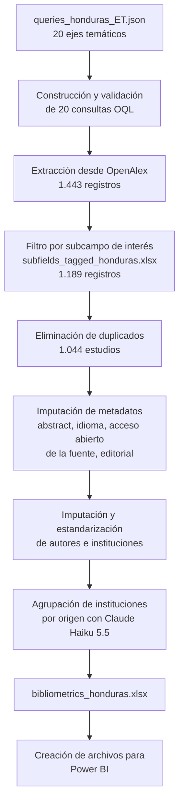
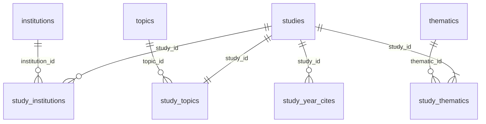

# Metodología del análisis bibliométrico de Honduras (2019–2026)

**Fecha del documento**: 2026-11-19 (cifras de la ejecución del 19 de noviembre de 2026)

Este documento describe cómo se construyen `bibliometrics_honduras.xlsx` y `bibliometrics_honduras_db.xlsx` en el desarrollo del procesamiento de datos biblométricos, la base de estudios académicos sobre Honduras que alimenta el reporte bibliométrico, en versión plana y en versión relacional. Aquí se explican los insumos, cada etapa y las decisiones que se tomaron.

## Contenido

1. [Objetivo y alcance](#1-objetivo-y-alcance)
2. [Insumos](#2-insumos)
3. [Flujo general](#3-flujo-general)
4. [Etapas del proceso](#4-etapas-del-proceso)
5. [Archivos de salida y diccionario de variables](#5-archivos-de-salida-y-diccionario-de-variables)
6. [Costos y reproducibilidad](#6-costos-y-reproducibilidad)
7. [Limitaciones](#7-limitaciones)

---

## 1. Objetivo y alcance

- **Objetivo:** Identificar la producción académica y la literatura gris sobre Honduras relacionada con los ejes temáticos de la estrategia del BID con el país, y caracterizarla por diferentes características.
- **Fuente principal:** [OpenAlex](https://openalex.org), un catálogo abierto de trabajos académicos (artículos, libros, informes, tesis…) con sus autores, instituciones, fuentes y temas.
- **Periodo:** publicaciones de 2019 a 2026.
- **Unidad de análisis:** el estudio. El archivo final tiene una fila por estudio.

Los conteos presentados están sujetos a la fecha de ejecución del desarrollo, tomelos como referencia.

## 2. Insumos

| Insumo | Descripción | Uso en el proceso |
|---|---|---|
| `queries_honduras_ET.json` | Definición del país, el periodo y los 20 ejes temáticos con sus palabras clave | Construcción de las consultas a OpenAlex y asignación del eje temático |
| `subfields_tagged_honduras.xlsx` | Los 252 subcampos de la taxonomía de OpenAlex, marcados como de interés (1) o no (0) | Filtro temático de los estudios |
| API de OpenAlex | Búsqueda de trabajos, consulta de autores e instituciones, y catálogos vigentes de tópicos y subcampos | Extracción, imputación, tabla `topics` y control del archivo de subcampos |
| Semantic Scholar y Europe PMC | Bases de datos bibliográficas con resúmenes (abstracts) | Imputación de abstracts |
| doi.org (Crossref / DataCite) | Registros oficiales de los DOI | Imputación de la editorial |
| API de ROR | *Research Organization Registry*, registro internacional de organizaciones de investigación con identificador, país y tipo | Completar el país, el nombre o el tipo de instituciones |
| API de Anthropic (Claude Haiku 5.5) | Modelo de lenguaje grande | Agrupación de las instituciones por origen |

### 2.1 `queries_honduras_ET.json`

Archivo con dos bloques:

- **`meta`**: parámetros generales de la búsqueda.
  - `country`: país del análisis ("Honduras"). También se usa como nombre de uno de los grupos de instituciones.
  - `start_year` / `end_year`: periodo (2019–2026).
  - `country_terms`: 11 términos que identifican al país en inglés y español: Honduras, Honduran, Hondurans, hondureño/a/os/as y afrohondureño/a/os/as.
- **`thematics`**: los 20 ejes temáticos definidos por expertos. Cada eje trae:
  - `thematic_id`: código de tres dígitos. El primer dígito es el pilar y el segundo, el objetivo estratégico;
  - `pillar`, `strategic_objective` y `expected_result`: la jerarquía de la estrategia (pilar → objetivo estratégico → resultado esperado);
  - `thematic_axis`: nombre corto del eje;
  - `keywords`: palabras clave bilingües (inglés y español), entre 6 y 21 por eje.

| Pilar | Objetivo estratégico | `thematic_id` | Eje temático | N.º keywords |
|---|---|---|---|---|
| 1. Mejorar la prestación de servicios públicos | 1.1 Calidad y acceso de los servicios públicos | 110 | Acceso y calidad de servicios | 10 |
| | | 111 | Agua y saneamiento | 12 |
| | | 112 | Acceso a electricidad | 11 |
| | | 113 | Movilidad urbana | 8 |
| | | 114 | Seguridad ciudadana | 11 |
| | 1.2 Capital humano y protección social, con enfoque en población vulnerable | 120 | Población vulnerable | 6 |
| | | 121 | Salud | 10 |
| | | 122 | Educación | 10 |
| | | 123 | Protección social | 6 |
| 2. Fortalecer la efectividad del gobierno | 2.1 Sostenibilidad fiscal | 210 | Sostenibilidad fiscal | 10 |
| | | 211 | Administración tributaria | 8 |
| | | 212 | Gasto público | 11 |
| | 2.2 Capacidad institucional y marcos regulatorios | 222 | Capacidad institucional | 18 |
| | | 223 | Gestión del riesgo y resiliencia | 7 |
| 3. Integración económica y productividad del sector privado | 3.1 Infraestructuras productivas y corredores económicos | 311 | Sistema eléctrico | 13 |
| | | 312 | Infraestructura logística | 8 |
| | | 313 | Facilitación del comercio | 6 |
| | 3.2 Rendimiento de la empresa y acceso a financiación | 321 | Productividad empresarial y financiamiento | 21 |
| | | 322 | Adopción tecnológica | 10 |
| | 3.3 Vías hacia el empleo formal | 331 | Mercado laboral | 16 |

### 2.2 `subfields_tagged_honduras.xlsx`

OpenAlex clasifica cada trabajo en una jerarquía de cuatro niveles: **tópico → subcampo (*subfield*) → campo (*field*) → dominio**. El tópico principal de un trabajo (`primary_topic`) lo asigna un modelo de OpenAlex a partir del título, el abstract y la fuente.

La tabla de subcampos se origina en `OpenAlex_topic_mapping_table.xlsx`, de esta obtienen las filas por subcampo y se construye `subfields.xlsx`, con los 252 subcampos agrupados en 26 campos. Sus columnas son:
- `id`, `name` y `name_alternative`: código, nombre y nombres alternativos;
- `description`: descripción, tomada de Wikidata (actualizada con la de la API de OpenAlex el 2026-11-19);
- `field`: campo al que pertenece;
- `url`: página del subcampo en OpenAlex.

Sobre esa tabla se agregaron dos columnas:
- `interest_subfield`: 1 si el subcampo es de interés para el análisis, 0 si no;
- `justificacion`: el eje o los ejes temáticos que justifican cada 1, para que la decisión se pueda auditar.

**Antecedente (V1, `subfields_tagged_V1.xlsx`).** Una primera versión marcó como de interés los subcampos representados en los tópicos de los estudios del reporte bibliométrico elaborado manualmente en la primera versión del reporte bibliométrico de Honduras. Esa versión solo reflejaba lo que el reporte manual había encontrado, no lo que los ejes temáticos requieren. Por eso se reemplazó con una revisión basada en criterios.

**Metodología de la versión usada.** Se hizo con asistencia de Claude Opus 5.5, en estos pasos:

1. **Matriz de relevancia por eje.** Para cada uno de los 20 ejes se identificaron las disciplinas de OpenAlex en las que se publicaría esa literatura. Por ejemplo, el eje de agua y saneamiento se publica en ciencias del agua, ingeniería ambiental y salud pública.
2. **Criterio de inclusión.** Un subcampo es de interés si es razonable que una parte relevante de los artículos sobre algún eje quede clasificada ahí. El foco está en **política pública y prestación de servicios**, no en ciencia básica. Por ejemplo, *Water Science and Technology* y *Public Health* entran; *Organic Chemistry* o *Astrophysics* no.
3. **Casos frontera.** Ante la duda se optó por incluir, para no perder estudios pertinentes. Por ejemplo, las especialidades médicas ligadas a la capacidad hospitalaria, la agronomía por la adopción tecnológica agrícola y la ingeniería civil por la infraestructura.
4. **Verificación con la página de OpenAlex.** Cuando el nombre o la descripción no bastaban, se revisaron los tópicos que agrupa el subcampo en su página de OpenAlex.
5. **Justificación.** A cada subcampo marcado se le registró el eje o los ejes que lo justifican.
6. **Control final.** Se revisó el conteo por campo y se verificó que los 20 ejes quedaran cubiertos por al menos un subcampo.

**Resultado:** 86 subcampos de interés y 166 excluidos, con los 20 ejes cubiertos. Los ejes que más subcampos justifican son Salud (121), Capacidad institucional (222) y Agua y saneamiento (111).

| Campo | Subcampos de interés | Ejemplos |
|---|---|---|
| Ciencias sociales | 18 | Administración pública, educación, transporte, demografía, estudios urbanos, derecho, ciencia política |
| Medicina | 13 | Solo las áreas ligadas al sistema de salud: salud pública, epidemiología, urgencias, materno-infantil, atención primaria, enfermedades infecciosas, informática en salud |
| Ingeniería | 11 | Ingeniería civil, eléctrica, industrial, construcción, riesgo y confiabilidad |
| Ciencias ambientales | 7 | Agua, saneamiento, residuos sólidos, contaminación, cambio climático |
| Negocios y gestión | 7 | Contabilidad, gestión de la innovación, estrategia, relaciones laborales |
| Energía | 4 | Sistemas eléctricos, energías renovables |
| Ciencias de la decisión | 4 | Investigación de operaciones, sistemas de información, estadística |
| Profesiones de la salud | 4 | Servicios de emergencia, gestión de información en salud |
| Economía, econometría y finanzas | 3 | Economía, finanzas |
| Ciencias de la Tierra | 3 | Riesgo de desastres: huracanes, inundaciones, deslizamientos, sismos |
| Otros (computación, psicología, enfermería, agricultura, etc.) | 12 | Sistemas de información, psicología educativa, agronomía |

Quedaron excluidas la ciencia básica y las especialidades clínicas sin relación con los ejes: química, física, matemáticas, ciencia de materiales, bioquímica, neurociencia, artes y humanidades, odontología, veterinaria y especialidades por órgano como cardiología u oncología.

**Limitación de la verificación:** durante la revisión, OpenAlex limitó el número de consultas permitidas y algunas páginas no cargaron. Esos subcampos se clasificaron según el conocimiento de la taxonomía de OpenAlex.

---

## 3. Flujo general



---

## 4. Etapas del proceso

### 4.1 Construcción de las consultas (OQL)

Las consultas usan **OQL** (*OpenAlex Query Language*), el lenguaje de consulta de OpenAlex. Se construye **una consulta por eje temático** con la siguiente estructura:

```
get works where year >= 2019 and year <= 2026
  and type is (article or report or dissertation or book or book-chapter or conference-paper or dataset or data-paper)
  and title-abstract has ((<términos de país>) AND (<palabras clave del eje>))
```

Decisiones:
- **Una consulta por eje.** Así el eje de cada estudio sale de la propia búsqueda, sin un paso posterior de clasificación, y las búsquedas son más específicas.
- **Campo de búsqueda `title-abstract`.** Los términos deben aparecer en el título o el resumen del trabajo, no en sus palabras clave ni en el texto completo. Esto reduce las menciones incidentales de Honduras.
- **Términos de país AND palabras clave.** El estudio debe referirse a Honduras **y** a algún tema del eje. Dentro de cada grupo, los términos se combinan con OR.
- **Stemming.** Por defecto, las palabras clave se buscan con `stemmed`, que también encuentra las variantes morfológicas (singular y plural, conjugaciones). Por ejemplo, "public service" encuentra "public services". Con el parámetro `--no-stemming` de `run_pipeline.py` las palabras clave se buscan como frase exacta. Los términos de país no cambian con este parámetro: los de una sola palabra se buscan sin stemming, porque el archivo ya lista sus variantes (hondureño, hondureña, hondureños…), y los de varias palabras con stemming.
- **Tipos de documento.** Se admiten 8 tipos de producción académica, literatura gris y datos: artículos (`article`), informes (`report`), tesis (`dissertation`), libros (`book`), capítulos (`book-chapter`), ponencias (`conference-paper`), conjuntos de datos (`dataset`) y artículos de datos (`data-paper`). Se excluyen tipos como resúmenes de congreso, erratas o editoriales.

### 4.2 Validación de las consultas

Antes de ejecutarlas, cada consulta se valida con el endpoint gratuito `https://api.openalex.org/query/oql/`. Este endpoint traduce y valida la OQL sin ejecutarla. Se exige que todas las consultas sean válidas para continuar.

El aviso `url_not_representable` es esperado y se ignora. Significa que la consulta no tiene equivalente en la sintaxis clásica de URL de OpenAlex, porque mezcla búsquedas con y sin stemming en el mismo OR. No afecta la ejecución.

### 4.3 Extracción

- Cada consulta se envía con una petición `POST` a la API de OpenAlex. La paginación es por cursor (un marcador que indica a la API dónde continuar), con 100 resultados por página y un máximo de 10.000 por consulta. Si una consulta superara ese máximo, el cuaderno lo advierte.
- Los resultados se ordenan por `relevance_score`, el puntaje con que OpenAlex mide qué tan bien coincide el trabajo con la búsqueda. Este orden puede repetir algunos trabajos entre páginas, así que se eliminan las repeticiones por identificador dentro de cada consulta.
- Si falla una página intermedia, se conservan las páginas ya obtenidas y se registra que la consulta quedó incompleta.
- La respuesta completa de cada eje se guarda como `thematic_{thematic_id}.json` como respaldo, junto con la OQL que la generó (`meta.pipeline_oql`). Si en una nueva ejecución la OQL de un eje cambia (tipos, campo de búsqueda, palabras clave o stemming), el proceso se detiene antes de consultar e indica qué respaldos borrar, para no mezclar resultados de búsquedas distintas.

**Resultado:** 1.443 registros de las 20 consultas, con un costo de $0,03 en OpenAlex.

### 4.4 Construcción de variables

De cada trabajo se conservan las variables de interés como:
- identificación y fechas
- idioma y tipo
- ubicación principal
- acceso abierto
- citas e impacto
- tópico principal y su jerarquía
- Objetivo de Desarrollo Sostenible (ODS) principal.

Los objetos anidados se transforman así:
- **Autores** (`authorships`, la lista de autorías del trabajo): el identificador y el nombre de cada autor se unen con ";", en el orden de autoría.
- **Instituciones:** las instituciones únicas del estudio (por identificador, en orden de aparición). Su identificador, nombre, país (`country_code`, código ISO de dos letras) y tipo se unen con ";", alineados entre sí. Las columnas de instituciones no están alineadas con las de autores: tienen una posición por institución, no por autor.
- **Abstract:** OpenAlex no entrega el resumen como texto, sino como un índice invertido (cada palabra con las posiciones en que aparece). Se reconstruye ordenando las palabras por posición y eliminando los caracteres no imprimibles.
- **Keywords:** las palabras clave que OpenAlex asigna al trabajo, unidas con ";".
- **ODS** (`sustainable_development_goals`, la lista de ODS que OpenAlex asigna al trabajo, cada uno con un puntaje): se conserva solo el nombre del ODS con mayor puntaje, que es el primero de la lista, en `sustainable_development_goals.display_name`. Queda vacío cuando OpenAlex no asigna ningún ODS.

Para que un nombre que contiene ";" no rompa la alineación de las listas, ese carácter se reemplaza por "," dentro de cada valor.

### 4.5 Filtro por subcampo de interés

Cada estudio se cruza con `subfields_tagged_honduras.xlsx` por el subcampo de su tópico principal (`primary_topic.subfield`), y se conservan solo los estudios de subcampos de interés.

Decisiones:
- **Subcampo en lugar de tópico.** El reporte de referencia filtraba por tópicos. Aquí se usa el subcampo porque es más fácil de estandarizar: son 252 categorías en lugar de los 4.516 tópicos. Además, la marca de interés puede reutilizarse en otros análisis.
- **Estudios sin subcampo:** se descartan. Son registros que OpenAlex no pudo clasificar y, en esta ejecución, son errores de catalogación: spam, anuncios y números completos de revistas.
- **Subcampo vigente.** Se usa el subcampo que trae el registro del trabajo, que refleja la asignación tópico → subcampo vigente de OpenAlex.
- **Control del archivo de subcampos.** Antes de consultar, el archivo se compara con los subcampos actuales de OpenAlex. Si OpenAlex agregó o retiró subcampos, el proceso se detiene para que se etiqueten. Si solo cambió el nombre o el campo de alguno, se registra un aviso. En esta ejecución los 252 ids coincidieron. Después se actualizaron en el archivo los nombres y descripciones que diferían de la API: 7 nombres con un sufijo de desambiguación (p. ej. *Biochemistry (medical)* en lugar de *Biochemistry*) y 7 descripciones erróneas que no correspondían al subcampo (p. ej. *Czech company* en *General Energy*). No cambió ninguna marca de interés.

**Resultado:** 1.189 registros de interés, 247 de subcampos excluidos y 7 sin subcampo.

### 4.6 Eliminación de duplicados

Un mismo estudio puede aparecer en varias consultas (si coincide con varios ejes) o con registros distintos (por ejemplo, la versión de la revista y la del repositorio). Los duplicados se identifican **en cascada**:

1. **Identificador de OpenAlex** (`id`).
2. **DOI** (*Digital Object Identifier*, identificador permanente de una publicación).
3. **Título normalizado** (minúsculas, espacios simplificados), solo si tiene **4 palabras o más**. Así no se fusionan títulos genéricos como "Honduras" o "Introduction".

En cada paso se ignoran los valores vacíos.

Reglas para fusionar:
- Se conserva la fila con mayor `relevance_score`.
- **Eje temático:** se identifica el objetivo estratégico del eje con mayor puntaje de relevancia entre las filas fusionadas. Se conservan todos los ejes temáticos de ese objetivo en los que apareció el estudio, unidos con ";" (p. ej. `210;211`). Los ejes de otros objetivos se descartan, de modo que cada estudio queda asociado a un solo objetivo estratégico.

**Resultado:** se eliminaron 137 duplicados por identificador, ninguno por DOI y 8 por título, y quedaron **1.044 estudios**. De ellos, 32 tienen más de un eje temático.

### 4.7 Imputación de metadatos

Primero, los textos vacíos se convierten en valores nulos para tratarlos de forma uniforme.

**DOI.** No se imputa. Faltan 144 (13,8 %), concentrados en tesis (90 % sin DOI), libros (28 %) e informes (27 %). Es literatura gris alojada en repositorios, que normalmente no registra DOI. Ninguna URL de esos estudios contiene un patrón de DOI, y las demás ubicaciones del trabajo en los respaldos tampoco lo traen.

**Abstract.** Se busca por DOI, en este orden:
1. **Semantic Scholar**, con consultas por lotes de 100
2. **Europe PMC**, para los que siguen sin abstract

- Resultado: 978 abstracts de OpenAlex, 21 de Semantic Scholar y 1 de Europe PMC, y quedan 44 sin abstract.
- `abstract_source` indica la fuente.

**Idioma.** Cuando OpenAlex no informa el idioma, se detecta con la librería `lingua`, restringida a 6 idiomas (inglés, español, portugués, francés, italiano y alemán).
- Se usa primero el **título** y, solo si no permite detectar el idioma, el abstract. En los estudios con idioma conocido, la detección sobre el título coincide con OpenAlex en 93 % y sobre el abstract en 84 %, teniendo en cuenta que estudios en español pueden traer el abstract traducido al inglés.
- `language_imputed` marca los estudios donde se imputa. En la última ejecución OpenAlex informó el idioma de todos los estudios, así que no hubo imputaciones.
- Distribución final: 569 estudios en inglés, 461 en español y 14 en otros idiomas.

**Editorial (`publisher`).** Se construye una sola variable de editorial u organización que publica el estudio para unificar diferentes niveles de descripción del origen y valores faltantes. Se toma el primer valor disponible de esta cascada:

| Orden | Fuente | Descripción | Estudios |
|---|---|---|---|
| 1 | `host_organization_name` | Organización que publica o aloja la fuente en OpenAlex (editorial, universidad, organismo) | 724 |
| 2 | `primary_location.source.display_name` | Nombre de la fuente (revista, repositorio, plataforma de libros) | 249 |
| 3 | `primary_location.raw_source_name` | Nombre de la fuente tal como aparece en el registro original, sin normalizar | 17 |
| 4 | Registro del DOI | Editorial registrada para el DOI en Crossref o DataCite, consultada por doi.org | 32 |
| 5 | Dominio de `landing_page_url` | Dominio de la página web donde se aloja el estudio. Los enlaces doi.org se resuelven a su destino final; algunos dominios conocidos se traducen a nombre, p. ej. documents.worldbank.org → World Bank | 22 |

- `publisher_source` indica el paso que aportó el valor.
- Todos los estudios quedan con editorial.

**Acceso abierto.** Se conserva `open_access.oa_status`, como referencia principal. La clasificación de OpenAlex es:
- gold: revista de acceso abierto con cargo al autor
- diamond: acceso abierto sin cargos
- hybrid: artículo abierto en una revista de suscripción
- green: existe una copia en un repositorio
- bronze: libre en el sitio de la editorial, pero sin licencia abierta
- closed: cerrado

**Acceso abierto de la fuente (`primary_location.source.is_oa`).** Indica si la fuente de la versión principal (revista, repositorio o plataforma) es completamente de acceso abierto. Es una propiedad de la fuente, no del estudio, por eso difiere de `open_access.is_oa`: un artículo hybrid, bronze o green se puede leer gratis aunque su revista no sea de acceso abierto. En la base, 350 estudios tienen `open_access.is_oa = True` en una fuente que no es de acceso abierto. El caso contrario no ocurre.
- Falta cuando OpenAlex no identificó la fuente: 71 estudios (6,8 %), en su mayoría informes y otra literatura gris.
- Se imputa desde `open_access.oa_status`, que en los 973 estudios con fuente identificada predice el valor casi sin error:
  - gold y diamond → `True`: se cumple en 419 de 419 estudios. Por definición, ambos estados implican una revista de acceso abierto.
  - hybrid, bronze y closed → `False`: se cumple en 381 de 381 estudios.
  - green no se imputa, porque es ambiguo: 20 estudios tienen una fuente de acceso abierto y 153 no.
- **Resultado:** 65 imputaciones (45 closed → `False`, 20 gold → `True`). Quedan 6 estudios green sin valor. `source_is_oa_imputed` marca los estudios imputados.
- Distribución final: 459 `True`, 579 `False` y 6 vacíos.


**FWCI y percentil de citas**
- El **FWCI** (*Field-Weighted Citation Impact*) divide las citas recibidas en el año de publicación y los tres siguientes por las citas esperadas para trabajos del mismo año, tipo y subcampo. 1,0 es el promedio mundial. El **percentil normalizado de citas** expresa lo mismo en escala percentil.
- OpenAlex **no calcula** estos indicadores para los tipos que no se espera que acumulen citas. En esta base, los 148 nulos son exactamente los informes, las tesis y los conjuntos de datos (73, 59 y 16). El nulo significa "no aplica", no "impacto cero".
- No se deben imputar con 0. Un estudio elegible sin citas sí recibe un valor (en esta ejecución, 409 de los 411 estudios elegibles sin citas tienen percentil 0), pero en los tipos no elegibles el indicador no existe, y un 0 los mezclaría con los estudios elegibles sin impacto.
- En el análisis, los promedios de FWCI y percentil se deben calcular solo sobre los tipos elegibles (`type = article, book, book-chapter y conference-paper`).

### 4.8 Autores e instituciones

Autores e instituciones se tratan como entidades independientes. Las columnas unidas con ";" se separan en listas, se completan y se vuelven a unir.

**Criterio de alineación.** En cada estudio, todas las columnas de un mismo grupo tienen el mismo número de elementos, en el mismo orden:
- **Autores:** identificador (`authorships.author.id`), nombre (`.display_name`) y marca de imputación (`.id_imputed`).
- **Instituciones:** identificador, nombre, país, tipo, organización raíz (`.root_display_name`) y agrupación (`.inst_group`).

**Valores faltantes.** Hay dos casos distintos:
- **Falta un elemento dentro de un campo con varios valores** (p. ej. un autor sin identificador entre autores que sí lo tienen, o una institución sin país): se reemplaza por **`"Not indicated"`** para conservar la posición y la alineación.
- **Falta el campo completo** (un estudio sin ningún autor o sin ninguna institución): todo el grupo queda **vacío (nulo)**.

**Situación inicial:** 8 estudios sin autores, 397 sin instituciones y 228 autores sin identificador. Los ids faltantes pasan a "Not indicated".

**Estudios sin ninguna autoría.** Se probaron como fuentes de autores el registro del DOI (Crossref/DataCite) y la página web del estudio, pero ninguna los recupera de forma útil. Muchos son documentos de autoría institucional (Naciones Unidas, OPS), que se tratan en el paso b).

Los pasos siguientes se aplican en orden y se concentran en los estudios sin instituciones.

**¿Por qué importa el orden?** Cada paso usa lo que dejan los anteriores y actúa solo sobre los estudios que siguen sin instituciones. Por eso, cambiar el orden cambia tanto el resultado como el costo:

1. **De la fuente más confiable a la menos confiable.** Las fuentes se usan en este orden:
   - las instituciones que trae el registro de OpenAlex;
   - las organizaciones que figuran explícitamente como autoras (a);
   - la editorial (b);
   - las instituciones inferidas desde el perfil de los autores (c y d).

   Una fuente menos precisa nunca se mezcla con una más precisa: a un estudio que ya tiene instituciones de OpenAlex no se le agregan afiliaciones inferidas.
2. **Cada paso reduce el trabajo, y el costo, del siguiente.** Una búsqueda por nombre cuesta unas 10 veces más que una consulta de fichas por lotes ($0,001 frente a $0,0001).
   - Limitar a) a los estudios sin instituciones bajó las búsquedas de ~690 a 306 (de ≈ $0,73 a ≈ $0,31) en la ejecución con la que se diseñó el proceso. En esta ejecución, a) buscó 249 nombres.
   - Hacer c) después de a) y b) limitó la búsqueda de autores a 71 nombres, en lugar de ~245, en esa misma ejecución de diseño. En esta ejecución, c) buscó 57 nombres.
3. **a) antes que c).** Los nombres reconocidos como instituciones (World Bank, OECD…) no se buscan después como personas. Así no se gastan búsquedas en nombres que no son de personas, ni se asigna por error el perfil de una persona a una organización.
4. **b) después de imputar el publisher (sección 4.7) y antes que c).** La editorial solo se puede buscar como institución cuando el publisher ya está completo. Los estudios que la reciben como autora institucional ya tienen institución, así que salen del grupo que se procesa en c) y d).
5. **c) antes que d).** d) recupera instituciones a partir de las afiliaciones de los autores con identificador. Los identificadores imputados en c) son los que permiten recuperar instituciones en estudios donde ningún autor estaba identificado.
6. **e) al final.** La estandarización necesita todas las instituciones, vengan de donde vengan. Así se logra lo siguiente:
   - el árbol institucional se consulta una sola vez;
   - el nombre, el país y el tipo se completan con el mismo criterio;
   - la unificación de identificadores (como en la UNAH) y la organización raíz se aplican a todas por igual.
7. **Todo antes de la agrupación por origen (sección 4.9).** La clasificación con Claude Haiku 5.5 usa la organización raíz y el país ya completados, y clasifica cada institución por su identificador unificado. Si se hiciera antes, una misma institución podría quedar con dos identificadores y recibir dos grupos distintos.

**Consultas en paralelo.** El orden *entre* pasos se mantiene. Dentro de cada paso, las consultas a OpenAlex se hacen en paralelo, con 8 hilos:

| Paso | Consultas en paralelo |
|---|---|
| Preparación | Fichas de los autores con identificador, en lotes de 50 |
| a) Autores que son instituciones | Búsqueda de cada nombre candidato en el catálogo de instituciones |
| b) Publisher como autor | Búsqueda de cada editorial candidata en el catálogo de instituciones |
| c) Identificador para autores sin identificador | Búsqueda de cada par (nombre, año) en el catálogo de autores |
| d) Afiliaciones | Fichas de los autores que faltan, en lotes de 50 |
| e) Estandarización | Fichas del árbol institucional, en lotes de 50. Los niveles (padres, abuelos…) se recorren uno tras otro, porque cada nivel depende del anterior |

El resultado no cambia respecto de hacerlas una por una. Cada consulta es independiente de las demás y las respuestas se reúnen en el mismo orden en que se pidieron. Solo cambia el tiempo: en Ecuador, la imputación tomaba ~2 horas con consultas secuenciales.

Para no exceder el límite de OpenAlex, todas las consultas, de todos los hilos, pasan por un limitador común. El limitador separa el inicio de cada solicitud y usa 2/3 del límite por segundo de la clave, que lee del endpoint gratuito `/rate-limit` (20 solicitudes/s con el límite de 30/s de una clave gratuita o prepagada). Las consultas de ROR, de Europe PMC y a Claude siguen siendo secuenciales.

#### a) Autores que son instituciones

En OpenAlex, algunos "autores" son organizaciones (World Bank, OECD, BID…).
- **Candidatos:** autores de estudios sin instituciones que cumplen dos condiciones.
  1. **No tienen id de autor, o tienen un perfil sin afiliaciones y sin ORCID** en un estudio de hasta 3 autores. Los estudios con más autores se asumen escritos por personas, para evitar consultas que casi nunca serían relevantes. ORCID es un identificador personal de investigadores que una organización no puede tener, así que un perfil con ORCID es una persona.
  2. **Su nombre tiene forma de organización.** Contiene alguna de estas señales:
     - una palabra o prefijo de organización: universidad, instituto, ministerio, banco, fundación, comisión, departamento, centro…;
     - la sigla de un organismo, como CEPAL, OECD, FMI o BID;
     - una forma jurídica, como S.A., Ltda. o Inc.;
     - un "&";
     - un término de país del archivo de queries (`country` y `country_terms`).

     También pasa un nombre que es solo una sigla en mayúsculas. Las listas están en español, inglés, portugués y francés, y son globales: no se ajustan por país. Están en `ORG_PREFIXES`, `ORG_WORDS`, `ORG_ACRONYMS` y `ORG_LEGAL_PATTERN` de `src/bibliometrics/config.py`.

  **Justificación del filtro de nombre.** Sin el filtro, en Ecuador se buscaron 6.668 nombres (USD ~7, casi todo el costo de la corrida) y solo 55 resultaron ser instituciones. Casi todas eran afiliaciones que OpenAlex registró como autor ("Universidad de Guayaquil. Ecuador") u organismos (World Bank, CEPAL, FMI). Ninguna tenía ORCID. Al aplicar el filtro a los datos de esa corrida, los candidatos bajan a ~110 y se conservan todas las coincidencias, igual que en Honduras (de 249 a ~21). Los nombres descartados son nombres de personas. `run_summary.json` registra en `org_candidates_filtered_out` cuántos nombres descartó el filtro.
- **Búsqueda:** cada nombre se busca en el catálogo de instituciones de OpenAlex. Se compara el nombre normalizado (sin tildes, mayúsculas ni puntuación) con el nombre, los nombres alternativos y las siglas de cada resultado.
  - La institución se asigna si la **similitud de texto es ≥ 0,85**. La similitud se mide por el emparejamiento de patrones Gestalt de Ratcliff y Obershelp, en una escala de 0 a 1 donde 1 es idéntico.
  - Se elige la más similar de los primeros 10 resultados, porque la coincidencia exacta no siempre aparece primera (p. ej. "United Nations" aparece después de FAO).
  - Si el nombre completo no coincide, se prueba con su primer segmento antes de ".", "," o "(", siempre que tenga dos palabras o más. Por ejemplo, "International Monetary Fund. Fiscal Affairs Dept." se reconoce como International Monetary Fund.
- **Asignación:** la institución se agrega a todos los estudios donde aparece ese nombre, si no tenía institución, y se marca con `author_as_institution` en `institutions_source`. El autor se conserva tal cual.
- **Resultado:** 249 candidatos y 10 nombres reconocidos, que corresponden a 9 instituciones: BID, Banco Mundial, World Bank Group, FMI, OCDE, PNUD, CEPAL, IFC y la Universidad Nacional de Ciencias Forestales. Algunos nombres son variantes de la misma institución. 31 estudios recibieron alguna institución.

#### b) Publisher como autor institucional

Para los estudios sin ninguna autoría cuya fuente no es una revista, se busca la editorial como institución, con el mismo método y umbral de similitud. Se asigna como autor y como institución (`publisher_as_author`) solo si el tipo de la institución es gobierno, organización sin fines de lucro, salud, instalación, financiador u otro.
- Se excluyen las **empresas**, porque son editoriales comerciales (Wiley, Springer…) que no son autoras del contenido.
- Se excluyen las **universidades**, porque suelen alojar o editar documentos sin firmarlos (p. ej. un repositorio universitario).

**Resultado:** de los 8 estudios sin autores, 7 son candidatos (el otro tiene una revista como fuente) y 5 se imputan: 4 de Naciones Unidas y 1 de la Organización Panamericana de la Salud (OPS), que OpenAlex registra como World Health Organization Regional Office for the Americas. Los otros 2 candidatos no recibieron autor: sus editoriales (Sistema Editorial Universitario UPNFM y Centro de Investigaciones y Capacitaciones Interdisciplinares SAS) no coincidieron con una institución de OpenAlex de un tipo aceptado. Al final quedan **3 estudios sin autores**.

#### c) Identificador para autores sin identificador

En los estudios que siguen sin instituciones, se busca en el catálogo de autores de OpenAlex a las personas sin identificador, casos donde hay un texto del nombre pero no un identificador. El identificador permite recuperar después sus afiliaciones.

**Regla de asignación** Se asigna el identificador si se cumplen dos condiciones:
1. El candidato tiene el **mismo nombre normalizado** (incluidos sus nombres alternativos) y una **afiliación a ±1 año de la publicación**.
2. Es el **único** candidato válido, o todos los candidatos válidos **comparten una institución**, que se interpretan como perfiles duplicados de la misma persona en OpenAlex y se elige el de mayor relevancia.

La regla se eligió con una evaluación previa:
- **Precisión:** se ocultó el identificador de 55 autores conocidos y se comparó el identificador asignado con el verdadero.
- **Cobertura:** se midió sobre 100 autores sin identificador.

| Regla | Precisión (autores con id) | Cobertura (autores sin id) |
|---|---|---|
| R0. Primer resultado con afiliaciones | 83 % | 80 % |
| R1. Nombre exacto | 88 % | 65 % |
| R2. Nombre exacto y mismo campo temático | 91 % | 40 % |
| R3. Nombre exacto y afiliación ±1 año | 91 % | 50 % |
| R4. R3 y mismo campo temático | 95 % | 31 % |
| **R3 flexible** (R3 con candidato único o candidatos que comparten institución) | **95 %** | **30 %** |

La confiabilidad depende de que no haya homónimos de instituciones distintas, en esos casos la precisión cae. Por eso se elige una la regla que prima no asignar antes que arriesgarse a la presencia de un homónimo en búsquedas generales.

**Resultado:** 57 búsquedas y 20 identificadores imputados, que ocupan 24 posiciones de autor porque algunos autores aparecen en varios estudios. `authorships.author.id_imputed` marca con `True` cada posición imputada.

#### d) Instituciones a partir de las afiliaciones de los autores

En los estudios que siguen sin instituciones se consulta el perfil de cada autor con identificador (incluidos los imputados). Se toman las instituciones de sus afiliaciones registradas **en el mismo año de publicación** del estudio. Cada afiliación del perfil indica la institución y los años en que el autor estuvo vinculado a ella. Estas instituciones se marcan como `author_affiliation`.

**Resultado:** los estudios sin instituciones bajan de 361 a **233**.

#### e) Estandarización de instituciones


1. **Árbol institucional.** Se consulta en OpenAlex la ficha de cada institución y de todas sus organizaciones superiores (padre, abuelo…), recorriendo las relaciones institucionales que registra OpenAlex (`associated_institutions`, de tipo padre, hijo o relacionada). 

2. **Campos faltantes.** El nombre, el país y el tipo se completan en cascada en caso de nulos en cualquier campo: primero el valor del estudio, luego la ficha de OpenAlex (recurriendo a los padres si es necesario) y luego el registro **ROR** de la institución. Lo que siga faltando queda como "Not indicated". En la última ejecución no hubo campos por completar: todas las instituciones traían nombre, país y tipo.

3. **Identificador canónico.** Las instituciones con el mismo nombre normalizado y el mismo país, pero distinto identificador, se unifican en el identificador más frecuente en la base. En esta ejecución no hubo casos. En una ejecución anterior se unificaron los dos identificadores de la Universidad Nacional Autónoma de Honduras (UNAH). Las instituciones con el mismo nombre en distintos países no se unifican, porque son entidades distintas (p. ej. los ministerios de salud de varios países).

4. **Organización raíz (`root_display_name`).** Se sube por las relaciones de tipo padre hasta llegar a una organización sin padre. Así, un instituto o una facultad se asocia a su universidad o sistema; por ejemplo, The Queen's Medical Research Institute → University of Edinburgh y University of Florida → State University System of Florida. Si hay varios padres, se elige el del mismo tipo y, si empatan, el de más publicaciones. Algunas raíces son gobiernos nacionales (p. ej. United States Army Medical Directorate → Government of the United States of America).

#### f) Controles

- todas las columnas de cada grupo tienen el mismo número de elementos en cada estudio
- No quedan elementos vacíos
- Cada identificador de institución tiene un solo nombre.

`institutions_source` indica el origen de las instituciones de cada estudio:

| Origen | Estudios |
|---|---|
| `openalex`: venían en el registro de OpenAlex | 647 |
| `author_affiliation`: afiliaciones de los autores en el año de publicación | 128 |
| `author_as_institution`: autores que son instituciones | 31 |
| `publisher_as_author`: publisher como autor institucional | 5 |
| Sin instituciones | 233 |

**Costo en OpenAlex de la etapa:** alrededor de $0,32 en total, cubierto por el plan gratuito de OpenAlex. La mayor parte corresponde a las búsquedas por nombre (≈ $0,001 cada una): los 249 nombres de a), los publishers de b) y los 57 autores de c). Las consultas de fichas por lotes cuestan mucho menos.

### 4.9 Agrupación de instituciones por origen

Cada institución se clasifica en uno de estos grupos:

| Grupo | Criterio |
|---|---|
| `Honduras` | Instituciones del país del análisis (tomado de `meta.country`) |
| `LAC` | América Latina y el Caribe, excluyendo Honduras |
| `USA & Canada` | Estados Unidos y Canadá |
| `Europe` | Países europeos, incluido el Reino Unido |
| `Multilateral organizations` | BID, Banco Mundial, OCDE, FMI, Naciones Unidas y sus agencias (PNUD, UNICEF, FAO, OIT…), CEPAL, OPS/OMS, BCIE, SICA y similares, **sin importar su país** |
| `Other institutions` | Resto del mundo |
| `Not indicated` | No es posible determinar el origen con la información disponible |

**Método:**
- La clasificación la hace **Claude Haiku 5.5** (`claude-haiku-5-5`), un modelo de lenguaje de Anthropic. El país por sí solo no basta: un organismo multilateral tiene el país de su sede (el Banco Mundial figura como US) y algunas instituciones no tienen país.
- Se clasifica cada **institución única**, no cada estudio. Así una institución recibe siempre el mismo grupo en todos los estudios y se envían menos datos al modelo.
- De cada institución se envían cuatro datos: nombre, país, tipo y organización raíz. Los valores "Not indicated" se envían como nulos.
- Instrucciones al modelo:
  - asignar exactamente una categoría a cada institución;
  - dar prioridad a la categoría multilateral sobre el país, usando también la organización raíz para reconocer oficinas nacionales de organismos internacionales (p. ej. una oficina nacional cuyo raíz es UNICEF);
  - inferir el país desde el nombre solo cuando sea evidente.
- **Salida estructurada.** El modelo debe responder con un formato fijo (una lista de pares institución–grupo) cuyos valores posibles se construyen a partir de la lista de grupos previa. Así el modelo solo puede responder categorías válidas. Una institución que el modelo no clasifica queda como "Not indicated".
- **Alineación.** El grupo se guarda en `authorships.institutions.inst_group`, alineado con las demás columnas de instituciones: un grupo por institución, en el mismo orden. Los estudios sin instituciones quedan con el campo vacío.

**Resultado:** 806 instituciones únicas, todas clasificadas, con un costo estimado de unos $0,02.

| Grupo | Instituciones únicas | Estudios con al menos una institución del grupo |
|---|---|---|
| Honduras | 16 | 328 |
| LAC | 261 | 235 |
| USA & Canada | 211 | 198 |
| Europe | 186 | 157 |
| Multilateral organizations | 29 | 101 |
| Other institutions | 103 | 51 |
| Sin instituciones | — | 233 |

Pocas instituciones hondureñas concentran muchos estudios: la UNAH y otras instituciones nacionales aparecen de forma recurrente.

---

## 5. Archivos de salida y diccionario de variables

El proceso entrega la misma información en dos formatos:

| Archivo | Estructura | Uso |
|---|---|---|
| `bibliometrics_honduras.xlsx` | Una sola hoja, con una fila por estudio y las entidades (autores, instituciones, ejes) como listas separadas por ";" | Revisión y auditoría: incluye las columnas que indican la fuente de cada imputación |
| `bibliometrics_honduras_db.xlsx` | Nueve hojas: una por entidad, una tabla puente por cada relación, las citas por año y los metadatos de la búsqueda | Análisis y tableros (Power BI): cada institución, tópico y eje aparece una sola vez y se relaciona con los estudios por llaves |

### 5.1 Base plana: `bibliometrics_honduras.xlsx`

Tiene una fila por estudio (1.044) y 48 columnas. En las columnas de lista, los valores se separan con ";". Las de autores están alineadas entre sí, y las de instituciones también.

| Variable | Descripción | Origen |
|---|---|---|
| `id` | Identificador del trabajo en OpenAlex | OpenAlex |
| `doi` | DOI (identificador permanente de la publicación) | OpenAlex |
| `display_name` | Título | OpenAlex |
| `relevance_score` | Puntaje de coincidencia con la búsqueda del eje (la fila conservada al deduplicar) | OpenAlex |
| `publication_year`, `publication_date` | Año y fecha de publicación | OpenAlex |
| `language` | Idioma (código ISO 639-1: en, es, pt…) | OpenAlex / imputado |
| `language_imputed` | `True` si el idioma se detectó con `lingua` | Construida |
| `primary_location.landing_page_url` | Página web donde se aloja la versión principal | OpenAlex |
| `primary_location.raw_source_name` | Nombre de la fuente tal como aparece en el registro original | OpenAlex |
| `primary_location.source.is_oa` | `True` si la fuente (revista, repositorio, plataforma) es completamente de acceso abierto. Es una propiedad de la fuente, no del estudio (ver sección 4.7) | OpenAlex / imputado |
| `source_is_oa_imputed` | `True` si `primary_location.source.is_oa` se imputó desde `open_access.oa_status` | Construida |
| `type` | Tipo de documento (article, book, report…) | OpenAlex |
| `open_access.is_oa` | Si el estudio tiene alguna versión de acceso abierto | OpenAlex |
| `open_access.oa_status` | Estado de acceso abierto (gold, diamond, hybrid, green, bronze, closed) | OpenAlex |
| `open_access.oa_url` | Enlace a la versión de acceso abierto | OpenAlex |
| `fwci` | *Field-Weighted Citation Impact*: citas relativas al promedio mundial de trabajos comparables (1 = promedio). Nulo cuando no aplica | OpenAlex |
| `cited_by_count` | Número de citas recibidas | OpenAlex |
| `citation_normalized_percentile.value` | Percentil de citas frente a trabajos comparables (0 a 1) | OpenAlex |
| `primary_topic.id`, `primary_topic.display_name` | Tópico principal del trabajo | OpenAlex |
| `primary_topic.subfield.*`, `.field.*`, `.domain.*` | Subcampo (código numérico), campo y dominio del tópico principal | OpenAlex |
| `openalex_updated_date` | Última actualización del registro en OpenAlex (no es la fecha de la extracción) | OpenAlex |
| `retrieved_date` | Fecha de la ejecución en que el estudio entró a la base. En una actualización, los estudios que ya estaban en la base relacional anterior conservan su fecha y solo los nuevos reciben la fecha de la ejecución | Construida |
| `authorships.author.display_name` | Nombres de los autores, en orden de autoría | OpenAlex / imputado |
| `authorships.author.id_imputed` | Por autor, `True` si su identificador se imputó por búsqueda | Construida |
| `authorships.institutions.id` | Identificadores de OpenAlex de las instituciones únicas del estudio | OpenAlex / imputado |
| `authorships.institutions.display_name` | Nombres de las instituciones | OpenAlex / imputado |
| `authorships.institutions.country_code` | País de cada institución (ISO de dos letras) | OpenAlex / ROR |
| `authorships.institutions.type` | Tipo de institución (education, government, nonprofit, company, healthcare, facility, funder, other…) | OpenAlex / ROR |
| `authorships.institutions.root_display_name` | Organización raíz de cada institución | Construida |
| `authorships.institutions.inst_group` | Grupo de origen de cada institución | Construida (Claude Haiku 5.5) |
| `institutions_source` | Origen de las instituciones del estudio | Construida |
| `abstract` | Resumen | OpenAlex / Semantic Scholar / Europe PMC |
| `abstract_source` | Fuente del resumen | Construida |
| `keywords` | Palabras clave asignadas por OpenAlex | OpenAlex |
| `sustainable_development_goals.display_name` | ODS con mayor puntaje asignado por OpenAlex. Vacío si no tiene ODS | OpenAlex |
| `thematic_id` | Eje o ejes temáticos del estudio (del mismo objetivo estratégico) | Construida |
| `thematic_axis` | Nombre de los ejes temáticos del estudio | `queries_honduras_ET.json` |
| `pillar` | Pilar de la estrategia al que pertenecen los ejes | `queries_honduras_ET.json` |
| `strategic_objective` | Objetivo estratégico de los ejes (uno por estudio, ver sección 4.6) | `queries_honduras_ET.json` |
| `publisher` | Editorial u organización que publica | Construida (cascada) |
| `publisher_source` | Paso de la cascada que aportó la editorial | Construida |

`thematic_axis`, `pillar` y `strategic_objective` se toman de `queries_honduras_ET.json` a partir de `thematic_id`. Si un estudio tiene varios ejes, se listan sin repetir los valores. El resultado esperado y las palabras clave de cada eje están en la hoja `thematics` de la base relacional.

### 5.2 Base relacional: `bibliometrics_honduras_db.xlsx`

La base plana se separa en tablas relacionadas por llaves. Las entidades (instituciones, tópicos y ejes temáticos) tienen su propia hoja, con una fila por entidad. Las tablas puente registran qué entidades corresponden a cada estudio. Así una institución tiene un solo nombre, país y grupo en toda la base, y los conteos por institución, tópico o eje no dependen de separar listas.

El diccionario completo de la base relacional está en `docs/diccionario_bibliometrics_bd.xlsx`. Para cada hoja y columna indica el tipo, la llave, el origen, el campo de OpenAlex del que proviene, los valores posibles y un ejemplo.



| Hoja | Llave | Filas | Contenido |
|---|---|---|---|
| `studies` | `study_id` | 1.044 | Una fila por estudio: metadatos, abstract, editorial, autores y citas |
| `institutions` | `institution_id` | 806 | Una fila por institución: nombre, país, tipo, organización raíz y grupo de origen |
| `study_institutions` | `study_id`, `institution_id` | 1.696 | Tabla puente estudio–institución |
| `topics` | `topic_id` | 4.516 | Catálogo completo de tópicos de OpenAlex con su subcampo, campo y dominio |
| `study_topics` | `study_id`, `topic_id` | 1.044 | Tabla puente estudio–tópico principal (`primary_topic`) |
| `thematics` | `thematic_id` | 20 | Ejes temáticos de `queries_honduras_ET.json`, con sus palabras clave y su consulta OQL |
| `study_thematics` | `study_id`, `thematic_id` | 1.077 | Tabla puente estudio–eje temático |
| `study_year_cites` | `study_id`, `year` | 1.475 | Citas recibidas por cada estudio en cada año |
| `metadata` | — | 1 | Parámetros de la búsqueda y fecha de la última actualización |

**Reglas generales:**
- **Identificadores sin prefijo.** Los identificadores de OpenAlex se guardan sin `https://openalex.org/` (p. ej. `W3164576808`, `I169009895`). Los de tópicos, subcampos, campos y dominios se guardan como número (`T10795` → `10795`), igual que en `subfields_tagged_honduras.xlsx`.
- **Sin columnas de trazabilidad.** No se incluyen `institutions_source`, `publisher_source`, `language_imputed`, `source_is_oa_imputed`, `abstract_source` ni `authorships.author.id_imputed`. Para revisar el origen de una imputación se usa la base plana.
- **Controles.** Antes de exportar se verifica que las llaves sean únicas, que cada institución tenga un solo valor por atributo y que todos los identificadores de las tablas puente existan en su tabla de entidad.

#### `studies`

Contiene las mismas variables de la base plana (sección 5.1), con estas diferencias:
- `id` se renombra como `study_id`, sin prefijo.
- Salen las columnas de instituciones (`authorships.institutions.*`), de tópico (`primary_topic.*`), de ejes (`thematic_id`, `thematic_axis`, `pillar`, `strategic_objective`) y de trazabilidad. Esa información pasa a sus propias hojas.
- Los autores siguen como lista separada por ";" (`authorships.author.display_name`), porque no tienen una tabla propia.

Quedan 24 columnas.

#### `institutions` y `study_institutions`

`institutions` tiene una fila por identificador de institución, con los atributos ya estandarizados en la sección 4.8 y el grupo de la sección 4.9:

| Variable | Descripción |
|---|---|
| `institution_id` | Identificador de OpenAlex de la institución (unificado, ver sección 4.8 e) |
| `display_name` | Nombre |
| `country_code` | País (ISO de dos letras) o "Not indicated" |
| `type` | Tipo de institución (education, government, nonprofit, company, healthcare…) |
| `root_display_name` | Organización raíz |
| `inst_group` | Grupo de origen (Honduras, LAC, USA & Canada, Europe, Multilateral organizations, Other institutions, Not indicated) |

`study_institutions` tiene una fila por cada par estudio–institución. Los 233 estudios sin instituciones no tienen filas en esta tabla, así que los indicadores por institución se calculan solo sobre los estudios con instituciones.

#### `topics` y `study_topics`

`topics` es el catálogo completo de tópicos de OpenAlex, no solo los de los estudios de la base. Así los tópicos de la base se pueden comparar con toda la taxonomía. Se descarga de la API de OpenAlex (versión vigente, unos $0,002) en la misma ejecución en que se consultan los ejes, y se guarda un respaldo en `bibliometrics_honduras_backup/topics_snapshot.json`, con su fecha y fuente en `meta`. Si en una reejecución todos los ejes salen de su respaldo, se reutiliza el catálogo guardado, para que estudios y catálogo sigan siendo de la misma fecha. Antes se usaba el *snapshot* público de S3, que puede tardar semanas en reflejar los cambios de la taxonomía. Sus columnas siguen la tabla de mapeo de tópicos de OpenAlex (`OpenAlex_topic_mapping_table.xlsx`):

| Variable | Descripción |
|---|---|
| `topic_id`, `topic_name` | Código numérico y nombre del tópico |
| `subfield_id`, `subfield_name` | Subcampo al que pertenece el tópico (se une con `subfields_tagged_honduras.xlsx` por `subfield_id`) |
| `field_id`, `field_name` | Campo |
| `domain_id`, `domain_name` | Dominio |
| `keywords` | Palabras clave que describen el tópico, separadas por ";" |
| `summary` | Descripción del tópico generada por OpenAlex |
| `wikipedia_url` | Artículo de Wikipedia asociado |
| `works_count` | Número de trabajos de OpenAlex clasificados en el tópico |
| `openalex_updated_date` | Última actualización del tópico en OpenAlex |

`study_topics` tiene una fila por estudio con su tópico principal. En la base relacional, el subcampo, el campo y el dominio de un estudio se obtienen del catálogo a través de `topic_id`, mientras que el filtro de la sección 4.5 usa el subcampo del registro del trabajo. OpenAlex puede reasignar un tópico a otro subcampo, campo o dominio; si el catálogo fuera de otra fecha que los registros, un estudio podría aparecer en la base bajo un subcampo distinto del que se usó para filtrarlo. Por eso el catálogo se descarga en la misma ejecución que los estudios, y además se compara el tópico, subcampo, campo y dominio de cada estudio con el catálogo: el número de estudios con diferencias queda en `run_summary.json` (`studies_with_topic_differences`) y debería ser 0. La base plana conserva siempre el `primary_topic.*` del registro del trabajo.

#### `thematics` y `study_thematics`

`thematics` reproduce los 20 ejes de `queries_honduras_ET.json` (sección 2.1):

| Variable | Descripción |
|---|---|
| `thematic_id` | Código del eje temático |
| `pillar`, `strategic_objective`, `expected_result` | Jerarquía de la estrategia. Tres ejes no tienen resultado esperado |
| `thematic_axis` | Nombre corto del eje |
| `keywords` | Palabras clave del eje, separadas por ";" |
| `n_keywords` | Número de palabras clave |
| `oql` | Consulta OQL con la que se extrajeron los estudios del eje (sección 4.1) |

`study_thematics` tiene una fila por cada par estudio–eje. Un estudio con `thematic_id = 210;211` en la base plana tiene dos filas. Hay 32 estudios con más de un eje, todos de un mismo objetivo estratégico (sección 4.6). Al contar estudios por pilar u objetivo estratégico se deben contar estudios distintos, para no duplicar los que tienen varios ejes.

#### `study_year_cites`

Tiene una fila por estudio y año, con las citas que el estudio recibió ese año. Se toma del campo `counts_by_year` de OpenAlex, que viene en la misma respuesta de la extracción y no tiene costo adicional.

| Variable | Descripción |
|---|---|
| `study_id` | Identificador del estudio |
| `year` | Año en que se recibieron las citas |
| `cited_by_count` | Citas recibidas en ese año |

OpenAlex solo reporta los años con al menos una cita y como máximo los últimos 10 años, así que un año sin fila equivale a cero citas y los estudios sin citas no tienen filas. En esta ejecución, 525 estudios tienen filas, con años de 2012 a 2026. 28 filas, de 23 estudios, tienen un año anterior al de publicación; se conservan tal como las reporta OpenAlex. La suma por estudio puede ser menor que `cited_by_count` de `studies`, que cuenta todas las citas.

#### `metadata`

Tiene una sola fila que documenta cómo se construyó la base:

| Variable | Descripción |
|---|---|
| `country`, `start_year`, `end_year`, `description`, `country_terms` | Objeto `meta` de `queries_honduras_ET.json`. Los términos de país van unidos con "; " |
| `search_fields` | Campo de búsqueda de la OQL (`title-abstract`) |
| `allowed_types` | Tipos de documento admitidos, unidos con "; " |
| `stemming` | `True` si las palabras clave se buscaron con stemming |
| `updated_date` | Fecha de la ejecución que actualizó los datos por última vez |

---

## 6. Costos y reproducibilidad

| Etapa | Servicio | Costo aproximado |
|---|---|---|
| Validación de las consultas | OpenAlex (endpoint gratuito) | $0 |
| Control de subcampos y catálogo de tópicos | OpenAlex | ~$0,003 |
| Extracción de los 20 ejes | OpenAlex | $0,03 |
| Imputación de autores e instituciones | OpenAlex | ~$0,32 |
| Abstracts, editorial, ROR | Semantic Scholar, Europe PMC, doi.org, ROR | Gratuito |
| Agrupación de instituciones | Anthropic (Claude Haiku 5.5) | ~$0,02 |

El costo total en OpenAlex es menor de $1, así que lo cubre el plan gratuito de OpenAlex.

El proceso es reproducible y depende únicamente del archivo json que define el protocolo.

---

## 7. Limitaciones

- **Literatura gris incompleta.** Tesis, informes y libros en repositorios suelen no tener DOI (13,8 % de los estudios), abstract (44 estudios) ni autores (3 estudios).
- **Cobertura institucional.** 233 estudios (22 %) quedan sin instituciones, sobre todo documentos cuyos autores no tienen perfil o afiliaciones en OpenAlex. Los indicadores por origen institucional se calculan sobre los estudios con instituciones.
- **Imputación de autores.** La regla elegida tiene una precisión estimada del 95 %, de modo que puede haber algunas asignaciones incorrectas, y solo recupera ~30 % de los autores sin identificador.
- **Clasificación de instituciones con un modelo de lenguaje.** No se validó manualmente de forma exhaustiva. Puede haber errores en instituciones con poca información (sin país o con nombres ambiguos). Además, el modelo no es determinista: en dos ejecuciones del 19 de noviembre de 2026 con las mismas 806 instituciones, unas pocas cambiaron de grupo (hasta 4 instituciones por grupo). Por eso los conteos por grupo pueden variar ligeramente entre ejecuciones.

